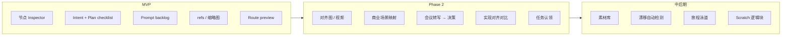

# Function Map Area 内容丰富化参考

**状态**：Draft v0.1  
**用途**：丰富 Function Map area 内容时的设计参考与分阶段落地指南  
**关联文档**：[Product-PRD.md](./Product-PRD.md)、[MVP-PRD.md](./MVP-PRD.md)、[MVP-Showcase-Architecture-and-Dev-Plan.md](./MVP-Showcase-Architecture-and-Dev-Plan.md)  
**关联代码**：`projectos/contracts/graph.ts`、`projectos/workbench/src/components/FunctionMap/`

---

## 1. 核心原则：地图是索引，不是仓库

Function Map 的首要价值是 **一眼看见产品结构 + 点选定位**，而不是把所有资料堆进节点卡片。

当前实现已保持克制：`FeatureNode` 展示名称、状态、路由、文件数、置信度；`graph.json` 中 `preview.thumbnail` 与 `refs` 已预留但 sample 中基本为空。

### 1.1 推荐的信息架构

| 层级 | 承载内容 | 用户感受 |
| --- | --- | --- |
| **地图画布** | 节点、边、状态色、轻量徽章（有笔记 / 有计划 / 有对齐图） | 鸟瞰、导航 |
| **节点 Inspector**（选中后侧面板或底部抽屉） | Notes、计划清单、媒体、会议摘要、决策记录 | 深度阅读 |
| **Chat** | Ask / Plan 模式的生成与讨论 | 产出结构化内容 |
| **Agent Flow / Diff / Harness** | 实现过程与验收证据 | 开发闭环 |

### 1.2 与三大可视化联动的约束

任一可视化层中的点选操作，均应触发（参见 Product-PRD §3.3）：

1. 右侧 AI Chat **context 自动切换**（目标 200ms 内）
2. Semantic File Tree **同步高亮**关联文件
3. Agent Flow **标注当前操作来源**

丰富 Function Map 内容时，**讨论在 Chat 完成，结构化产出写回节点 artifact**；不要把地图变成第二个聊天窗口。

### 1.3 UI 材质约束

Function Map 节点与 Inspector 属于 **content layer**，使用 solid surface（`--color-bg-elevated`），**不使用 Liquid Glass**。玻璃材质仅用于导航 chrome（参见 `.cursor/skills/apple-inspired-ui/components/content-surfaces.md`）。

---

## 2. 现状与可扩展点

### 2.1 当前节点 Schema（`FunctionalNode`）

```text
id, type, name, nameEn, status, description, summary
linkedFiles, upstream, downstream
preview: { route?, thumbnail? }
confidence, tags, parentId, children, refs, depth
```

**状态枚举**：`active` | `in_progress` | `error` | `suggested`

**边关系枚举**：`depends_on` | `redirects_to` | `data_flows_to` | `imports` | `shares_data`

### 2.2 当前 UI 展示（`FeatureNode`）

- 状态色点 + 中文名 + 可选英文名
- 路由（`preview.route`）
- 关联文件数 + 置信度条
- `suggested` 节点虚线样式

### 2.3 已预留、待利用的字段

| 字段 | 建议用途 |
| --- | --- |
| `preview.thumbnail` | 对齐预览图缩略图、路由 live preview 截图 |
| `refs` | 指向 node artifact、外链（Figma / Loom）、决策 ID、素材 ID |
| `tags` | 场景标签、素材类型、商业画布分类 |
| `parentId` / `children` | 功能层级、用户旅程分组 |
| `description` / `summary` | Intent 摘要的短版本（详情放 artifact） |

---

## 3. 内容模型：三层意图 + 证据链

将「Notes」拆成三种不同性质的文档，对应 Ask → Plan → 验收的完整路径。

### 3.1 Intent（意图层）— Ask 模式产出

**回答**：这个模块解决谁的什么问题？边界是什么？明确不做什么？

| 属性 | 说明 |
| --- | --- |
| 来源 | 用户与 AI 讨论 product idea、scope、用户场景 |
| 形态 | 每节点一份结构化摘要（Markdown 或 JSON block） |
| 更新时机 | Ask 模式对话结束后，AI 提炼 + 用户确认 |
| 地图表现 | Inspector Overview Tab；节点可选 📝 徽章 |

### 3.2 Plan（计划层）— Plan 模式产出

**回答**：具体开发项有哪些？优先级、依赖、验收标准是什么？

| 属性 | 说明 |
| --- | --- |
| 来源 | Plan 模式对模块制定开发计划 |
| 形态 | **可勾选 checklist**，每项带 acceptance criteria |
| 与 Chat 联动 | 未完成项一键生成 prompt，进入 Prompt Backlog |
| 地图表现 | 节点显示计划进度（如 `2/5`）；Inspector Plan Tab |

**Plan Item 建议字段**：

```json
{
  "id": "plan_login_error_ui",
  "title": "错误态 UI",
  "status": "pending",
  "priority": "high",
  "acceptanceCriteria": ["显示无效凭证提示", "支持重试"],
  "blockedBy": [],
  "linkedPromptId": null
}
```

### 3.3 Evidence（证据层）— Vibe Coder 验收

**回答**：哪些已经实现？证据是什么？未实现的下一步是什么？

| 属性 | 说明 |
| --- | --- |
| 已实现 | diff 应用成功、测试通过、路由可访问 → **自动建议打勾**，用户确认 |
| 未实现 | 生成续作 prompt，写入节点级 Prompt Backlog |
| 证据来源 | Agent run、diff record、harness 结论、smoke check |
| 地图表现 | 节点 `verified` 或进度环；Activity Tab 时间线 |

### 3.4 Prompt Backlog（节点级待办队列）

未实现项不只生成 prompt，还应记录阻塞关系：

```json
{
  "id": "pb_session_persist",
  "nodeId": "feat_login",
  "prompt": "为登录模块实现 session 持久化...",
  "priority": "medium",
  "blockedBy": "feat_database",
  "reason": "需先完成 auth schema 迁移"
}
```

地图上可高亮阻塞边（`feat_login` → `feat_database`）。

---

## 4. 媒体与对齐内容

### 4.1 分层挂载策略

不要把完整媒体塞进地图节点卡片；采用 **徽章 + Inspector 详情** 模式。

| 媒体类型 | 挂载位置 | MVP 可行度 | 说明 |
| --- | --- | --- | --- |
| 图表（用户旅程、架构示意） | 项目级或节点 Inspector Media Tab | 高 | 外链或本地 PNG / SVG |
| 对齐视频 / 链接 | 节点 `refs` + 对齐预览 Tab | 中 | 先链接 + 缩略图；Phase 2 接生视频 |
| 官方素材库 | Workspace 级 Asset Library，节点 tag 关联 | 低 | 中后期 + 版权集体采购 |
| 会议录音转文字 | 决策日志，AI 提取 action items 并关联节点 | 中 | 转写文本 → 结构化 decision |

### 4.2 地图上的轻量呈现

节点卡片仅增加小徽章，保持图谱可读性：

| 徽章 | 含义 |
| --- | --- |
| 🎯 | 有对齐预览 |
| 📝 | 有待办计划项 |
| 🎬 | 有演示视频链接 |
| ⚠️ | 对齐漂移（实现与目标不一致） |
| ✅ | 计划项全部验收 |

完整内容在 Inspector 中展开；`preview.thumbnail` 承载对齐图或路由截图。

### 4.3 与 Product PRD Phase 2 的衔接

Product-PRD §6.7–6.8 已规划：

- **商业画布** → 应用场景 → 双向链接功能节点
- **产品对齐预览**（生图 / 生视频）↔ 功能地图联动
- **当前实现 vs 对齐目标**并排对比
- **导出分享**用于融资 / 团队对齐

当前媒体构想本质是 Phase 2「产品对齐可视化」的前置；MVP 可先支持外链与本地缩略图。

### 4.4 素材库（中后期）

建议作为 **Workspace 级能力**，不绑死在单项目 Function Map：

| 维度 | 说明 |
| --- | --- |
| 优势 | 版权集中采购、跨项目复用、可商业化 |
| 劣势 | 存储 / CDN / 检索 / 授权追踪，工程量大 |
| 与节点关系 | `assetId` + `usage: ["feat_login.hero", "feat_checkout.sfx"]` |

---

## 5. 建议扩展的状态维度

在现有 `active | in_progress | error | suggested` 之上，可增加 **计划 / 对齐 / 验收** 维度（可作为 node artifact 字段或 secondary badge，不必全部塞进 `status` 枚举）：

| 维度 | 含义 | 地图表现 |
| --- | --- | --- |
| `planned` | 有计划但未开工 | 虚线边框 + 计划徽章 |
| `aligned` | 有对齐预览且未漂移 | 对齐图角标 |
| `drifted` | 实现与对齐目标不一致 | 橙色警告 |
| `verified` | 计划项全部验收 | 勾选进度环 |

实现时注意与现有 demo 状态机（`in_progress` → `active`）兼容。

---

## 6. 数据存储建议

**保持 `graph.json` 轻量**；大段内容与媒体走独立文件，节点通过 `refs` 引用。

```text
.projectos/
  graph.json                    # 节点元数据 + refs 指针
  node-artifacts/
    feat_login.json             # intent, plan, media refs, decisions, backlog
  alignments/
    feat_login-v2.png           # 对齐预览资产
  assets/                       # 中后期：项目级素材索引
  decisions/
    dec_20260711_oauth.json     # 决策日志
```

### 6.1 `node-artifacts/{nodeId}.json` 草案结构

```json
{
  "version": "0.1.0",
  "nodeId": "feat_login",
  "intent": {
    "summary": "OAuth + Google 一键登录",
    "scope": ["Google OAuth", "邮箱密码"],
    "outOfScope": ["企业 SSO"],
    "updatedAt": "2026-07-11T00:00:00.000Z",
    "sourceChatId": "chat_abc"
  },
  "plan": {
    "items": [
      {
        "id": "plan_1",
        "title": "LoginForm 组件",
        "status": "done",
        "acceptanceCriteria": ["渲染登录表单"]
      }
    ]
  },
  "promptBacklog": [],
  "mediaRefs": [
    { "type": "alignment_image", "path": "alignments/feat_login-v2.png" },
    { "type": "external", "url": "https://figma.com/...", "label": "Figma" }
  ],
  "decisionIds": ["dec_20260711_oauth"],
  "activityIds": ["run_xyz", "diff_abc"]
}
```

新增 schema 时放在 `projectos/contracts/`，与 `graph.ts` 并列，遵循现有 Zod + strict 模式。

---

## 7. Inspector UI 参考形态

选中节点后，Inspector 建议分 Tab：

| Tab | 内容 |
| --- | --- |
| **Overview** | Intent 摘要、状态、关联文件、上下游节点 |
| **Plan** | Checklist + 每项「生成 prompt」+ 阻塞原因 |
| **Media** | 对齐图、视频链接、Figma 等外链 |
| **Activity** | Agent runs、diffs、harness、会议决策时间线 |

### 7.1 线框示意

```text
┌─ Function Map ─────────────────┐  ┌─ Inspector ────────────────────┐
│  [登录] 📝2 🎯                    │  │ Tab: Overview | Plan | Media   │
│    ↓                             │  │                                │
│  [仪表盘]                        │  │ Intent: OAuth + Google 一键登录 │
│                                  │  │                                │
│                                  │  │ Plan (2/5):                    │
│                                  │  │ ☑ LoginForm 组件               │
│                                  │  │ ☑ /api/auth route              │
│                                  │  │ ☐ 错误态 UI  ← [生成 prompt]   │
│                                  │  │ ☐ Session 持久化               │
│                                  │  │ ☐ 对齐验收                     │
│                                  │  │                                │
│                                  │  │ Media: [对齐图] [Figma 链接]    │
└──────────────────────────────────┘  └────────────────────────────────┘
```

地图保持干净；丰富内容在 Inspector；Chat 讨论后自动回写 Plan / Intent。

---

## 8. 额外建议能力（易遗漏但高价值）

### 8.1 验收标准与测试场景

每个 plan item 附带 Given / When / Then 或演示脚本步骤；支持一键 smoke check 并回写节点状态。与 `docs/demo-script-5min.md`、`docs/presentation-smoke-checklist.md` 思路一致。

### 8.2 用户旅程切片（User Journey Slice）

将「登录 → 仪表盘 → 设置」等旅程作为场景分组；节点可属于多个场景。与 Phase 2 商业画布「应用场景列表」自然衔接。

### 8.3 决策日志（Decision Log）

会议转写、Ask 模式中「我们决定用 OAuth」→ 结构化 decision：

- 时间、参与者、理由、影响节点
- 实现偏离时可回溯「当初为何如此定」

参见 Product-PRD §6.9 Workspace「决策日志协作」。

### 8.4 对齐漂移检测（Alignment Drift）

有对齐预览 + 实际路由时：定期截图对比 / 视觉 diff → 节点标 `drifted`，Chat context 带上「目标 vs 现状」。

### 8.5 外部工具链接层

Figma frame、Notion spec、Linear issue、GitHub PR — 统一写入 `refs`，Function Map 作为 hub，不逼用户搬家。

### 8.6 Live Route Preview

利用已有 `preview.route`，对 Web 项目做嵌入式预览或自动截图，让节点从「名字」变成「看得见的产品切片」——MVP 性价比高。

### 8.7 节点 Activity 时间线

聚合：chat 摘要、agent runs、diffs、harness、会议决策、状态变更。新人点一个节点即可了解该功能的演化过程。

### 8.8 结构化树视图（备选）

节点过多时 2D 图易乱；同一 area 提供 view toggle：图谱 ↔ 可折叠树（MVP-PRD F2.2.5）。

### 8.9 热度 / 关注度 Overlay（后期）

哪些节点 AI 改动最多、报错最多、讨论最多 → 热力图，辅助发现技术债与过度投入区域。

---

## 9. 分阶段落地路线图



| 阶段 | 交付重点 | 预期结果 |
| --- | --- | --- |
| **MVP** | Inspector + Plan checklist + prompt backlog + refs / 缩略图 + route preview | 地图从「结构导航」升级为「开发任务入口」 |
| **Phase 2** | 对齐预览、商业场景链接、会议决策、任务认领、实现对齐对比 | 覆盖 Idea → 产品上游段 |
| **中后期** | 素材库、自动漂移、版权采购、旅程泳道、Scratch 逻辑块 | 平台化与商业化 |

### 9.1 MVP 优先五项（建议实现顺序）

1. **节点 Inspector 面板**（地图与详情分离）
2. **Intent / Plan / Evidence 三层 artifact**（替代泛泛 notes）
3. **Plan checklist ↔ Prompt backlog ↔ Agent 验收** 闭环
4. **`refs` + `preview.thumbnail`** 承载媒体与外链
5. **决策日志 + 会议转写关联节点**（为 Phase 2 预埋 schema）

### 9.2 明确延后项

- 商用素材库与版权集体采购
- 对齐视频自动生成（接生视频模型）
- 自动视觉漂移检测
- 地图 CRDT 多人实时协同编辑

---

## 10. 与现有系统的对接点

### 10.1 Context 服务

`ContextPayload`（`projectos/contracts/context.ts`）在节点选中时应扩展携带：

- Intent 摘要（写入 `summary` / `rawContextMarkdown`）
- 未完成 plan items（供 Chat 续作）
- 对齐预览引用（供 Plan 模式对比）

### 10.2 Prompt Refinement

未完成 plan item 点击「生成 prompt」→ 走现有 Prompt Refinement 流程 → 确认后 Agent Flow 执行 → diff 应用后回写 plan item 状态。

### 10.3 Current Work

`current-work.json` 的 `focusedNodeId` 与 Inspector 打开状态联动；`recentChanges` 可驱动 Activity Tab。

### 10.4 状态同步路径

```text
用户选中节点
  → current-work.focusedNodeId 更新
  → getNodeContext(nodeId) 合并 graph + node-artifact
  → Chat context header 更新（<200ms）
  → Semantic File Tree 高亮 linkedFiles
  → Inspector 懒加载 artifact

Agent 完成 / Diff 应用 / Harness 修复
  → 更新 plan item 建议状态
  → 更新 graph node status（active / error / in_progress）
  → 写入 activity 记录
```

---

## 11. 风险与注意事项

| 风险 | 缓解 |
| --- | --- |
| 地图变成第二 Chat | 讨论仅在 Chat；产出结构化写回 artifact |
| 计划与代码不同步 | 尽量从 diff / agent / harness 自动推断，用户确认 |
| 性能（大图 + 媒体） | 媒体懒加载；地图仅缩略图与徽章 |
| 信息过载 | 画布稀疏、Inspector 密集；树视图作备选 |
| 与 File Tree 职责重叠 | 地图管「做什么」，语义树管「代码在哪」 |
| Schema 膨胀 | `graph.json` 保持轻量；详情走 `node-artifacts/` |

---

## 12. 验收标准（本参考文档落地时）

丰富 Function Map area 的迭代可参照以下检查项：

- [ ] 选中节点后 200ms 内 Chat context 包含 Intent 摘要
- [ ] Inspector 与地图选中态双向同步
- [ ] Plan item 可生成 prompt 并进入现有 Refinement 流程
- [ ] Diff 应用后 plan item 收到「建议完成」提示
- [ ] `refs` 外链与 `preview.thumbnail` 在 Inspector Media Tab 可预览
- [ ] 节点徽章不遮挡图谱可读性（单节点最多 2–3 个徽章）
- [ ] 新增 schema 通过 `projectos/contracts` Zod 校验
- [ ] Demo reset 可恢复 graph + node-artifacts 到初始场景

---

## 13. 变更记录

| 版本 | 日期 | 说明 |
| --- | --- | --- |
| v0.1 | 2026-07-11 | 初稿：基于 Function Map 内容丰富化讨论整理 |
