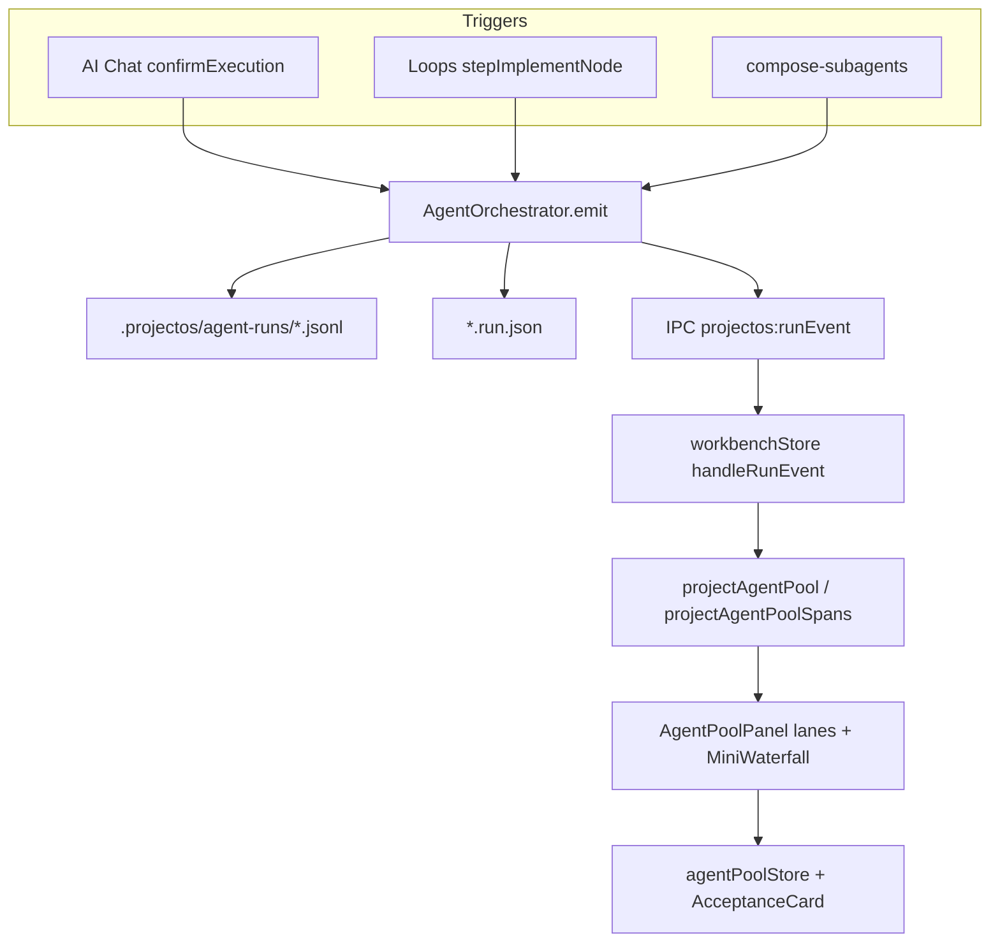
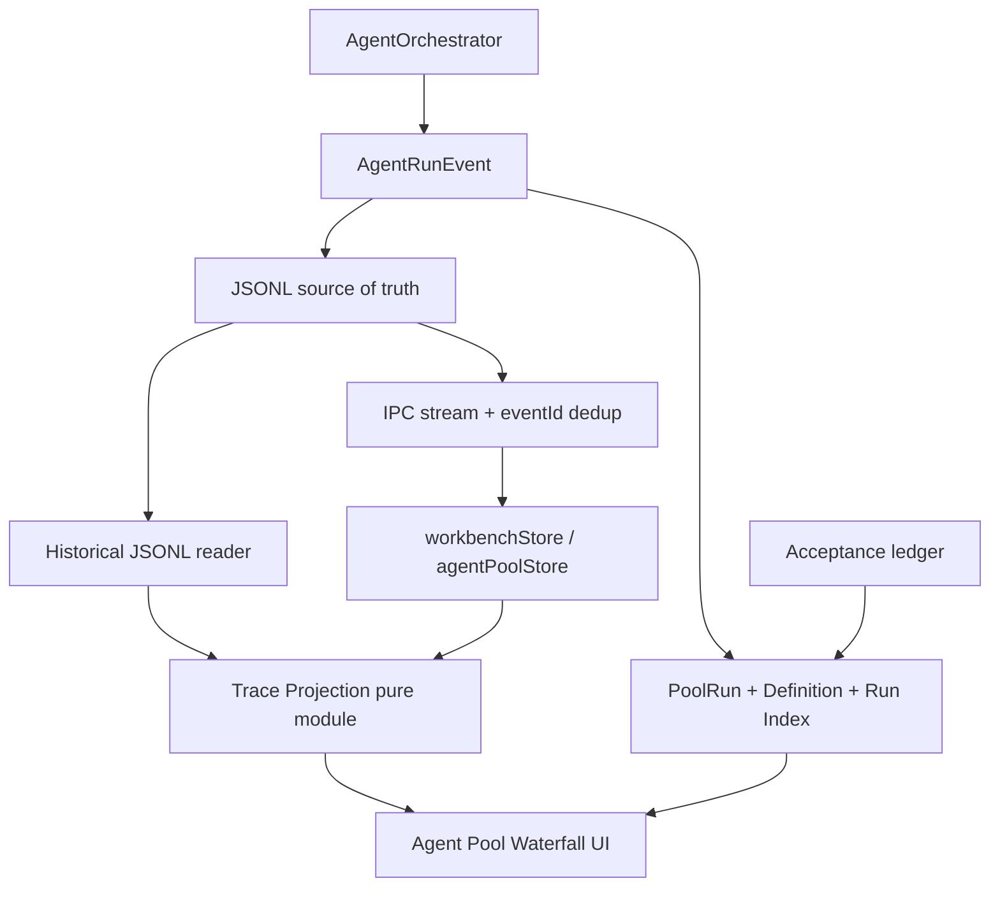

# Agent Pool × Trace Waterfall v1.0 — Optimization & Upgrade DevPlan

**Status:** Phases 1–5 wired (2026-11-03). UX polish / Kobra-grammar motion moved to [`Agent-Pool-Waterfall-UX-Dev-Plan.md`](./Agent-Pool-Waterfall-UX-Dev-Plan.md) **v1.1**. Remaining non-UX: optional Phase 6 load/perf validation; richer History span rehydrate.  
**Scope:** Upgrade the existing Agent Pool (M0–M4) into a hierarchical execution-observability surface by projecting real `AgentRunEvent` evidence onto a shared-time Waterfall, without rebuilding Agent Runtime or copying Kobra UI wholesale.  
**Authority:** This document is the v1.0 upgrade plan for Agent Pool Trace Waterfall (identity, projection, history, acceptance). UX grammar upgrades: see v1.1.  
**Baseline (implemented):** [`Agent-Pool-Dev-Plan.md`](./Agent-Pool-Dev-Plan.md) — M0–M4 situation surface, mini waterfall, Done → Chat acceptance.  
**Cross-refs:**
- [`Agent-Flow-Activity-Dev-Plan.md`](./Agent-Flow-Activity-Dev-Plan.md) — Timeline / Graph deep-read
- [`Live-Graph-Agent-Observability-Dev-Plan.md`](./Live-Graph-Agent-Observability-Dev-Plan.md) — C4 spatial overlay (separate surface)
- [`Loops-Graph-Workflow-Studio-Dev-Plan.md`](./Loops-Graph-Workflow-Studio-Dev-Plan.md) — orchestration; Pool is not the scheduler
- [`backend/Session-State-Dev-Plan.md`](./backend/Session-State-Dev-Plan.md) — sessionId ≠ runId
- Contracts: `projectos/contracts/agent-run.ts`, `projectos/contracts/events.ts`
- Reference interaction: [Kobra Trace Waterfall](https://kobra.systems/components/trace-waterfall)

**Locked product principles:**
1. JSONL `AgentRunEvent` logs are the source of truth.
2. Waterfall is a **rebuildable projection**, not a second event store.
3. Default density = **Major Actions**; Spans disclose progressively.
4. Execution complete ≠ human accepted.
5. Agent Pool visualizes concurrency that actually exists; it does not schedule Loops parallelism.
6. Do not invent timing, success, or completion when evidence is missing.

---

## 1. Executive Summary

### Verified baseline

Project OS already has:

| Layer | Verified location | Role |
|---|---|---|
| Agent Runtime | `projectos/services/agent-orchestrator/index.ts` (`AgentOrchestrator`) | Executes runs, emits events |
| Run identity | `projectos/contracts/agent-run.ts` (`AgentRun`) | `runId`, status, parent/root links |
| Events | `projectos/contracts/events.ts` | Lifecycle / action / delegation |
| Persistence | `.projectos/agent-runs/<runId>.jsonl` + `<runId>.run.json` | Durable evidence |
| Stream | `ProjectOSLocalApi.streamAgentRun` + IPC `projectos:runEvent` | Live delivery with `eventId` dedup |
| Pool UI | `workbench/.../AgentFlow/AgentPool/*` | Lanes, mini waterfall, Done → Chat |
| Acceptance | `ChatPanel/AgentPoolAcceptanceCard.tsx` + `agentPoolStore` | Ephemeral accept / continue |

### Gap vs Trace Waterfall v1.0

| Gap | Evidence |
|---|---|
| No independent `AgentPoolRun` id | Pool rows keyed by ephemeral `taskId` (`root:…`, delegation taskId, …) |
| No stable `AgentDefinition` id | Identity folded into task title / model / slot |
| History not durable | `historyByTaskId` lives only in Zustand; lost on reload |
| Acceptance not durable | `acceptTask` only removes row from overlay |
| Major Actions not hierarchical | When action events exist, `projectAgentPoolSpans` flattens leaf actions and skips steps as L1 |
| Shared Pool time axis incomplete | Each lane has its own `originMs`; only `nowMs` is shared |
| Expand is accordion | Single `expandedTaskId`, not independent multi-lane expand |
| No Span Inspector | Expand shows label + kind only |
| No `runSequence` | Events have `eventId` + ISO `timestamp`, no monotonic per-run sequence field |
| Snapshot/subscribe race partially handled | Server stream dedups + replays existing; frontend also does `getAgentRunEvents` then stream — needs explicit watermark contract |

### Recommended approach

**Upgrade in place.** Reuse Orchestrator, JSONL, IPC, Pool components, and acceptance UX. Add:

1. Stable Definition + independent PoolRun contracts and filesystem index.
2. Shared pure **Trace Projection** (Major Action / Sub Action / Span) from JSONL.
3. Event consistency (per-run sequence + snapshot watermark).
4. Waterfall UI: shared axis, Major Action bars, inline expand, Inspector, durable History.

Do **not** introduce SQL, a second event bus, `.spans.json` as truth, or Loops parallel scheduling.

---

## 2. Kobra Trace Waterfall Reference Analysis

**Source inspected:** https://kobra.systems/components/trace-waterfall (live component docs).  
**Also noted:** Closely related public Trace Waterfall APIs (AffectUI / Definable-style variants) document a richer tree API that matches the visual language Kobra markets; Project OS adapts **concepts**, not a vendor package.

### Observed Kobra / Trace Waterfall concepts

| Concept | What the reference does | Notes |
|---|---|---|
| `spans` + `now` | Required props: span tree/list + live clock | Running spans omit end and grow to `now` |
| Relative clock | `start`/`end` in ms from run start | Shared axis within one trace |
| Nested spans | Parent/child tree (agent → llm/tool children) | Collapse / expand by span id |
| Kind tint | agent / llm / tool (and similar) | Visual encoding of operation type |
| Status | running / done / failed | Failed often red; running animated |
| Details popover | Select span → detail (input/output/error/model/tokens) | Built on Base UI Popover on Kobra page |
| Aggregate header | Duration, cost, tokens, LLM/tool/error counts | Product-level summary strip |
| Slowest mark | Optional “slowest” finished LLM/tool | Useful but secondary |
| minRange | Minimum axis length so short runs remain readable | Project OS already has `AGENT_POOL_MIN_RANGE_MS = 2000` |

### Adaptation matrix

| Kobra Concept | Original Purpose | Project OS Adaptation | Adopt / Modify / Defer |
|---|---|---|---|
| Shared `now` clock | Grow running bars | Keep / evolve `useAgentPoolNow` | **Adopt** |
| Relative start/end ms | Position bars | Keep relative ms; add **Pool-level absolute origin** so lanes align | **Modify** |
| Nested span tree | Parent/child ops | Map to Major Action → Sub Action → Trace Span; default collapse below Major Action | **Modify** |
| Kind tint | Encode op type | Map to existing event kinds (`model`, `tool`, `file`, `step`, …) using Project OS tokens — not Kobra palette | **Modify** |
| Status encoding | running/done/failed | Map to AgentRun / step / action statuses; add cancelled / awaiting_review as Project OS states | **Modify** |
| Details popover | Inspect one span | Inline **Span Inspector under the lane** (not a foreign popover skin); reuse redaction | **Modify** |
| Cost / tokens header | Run economics | Show only when `model_request.usage === "reported"`; no fake zeros-as-estimates | **Modify** (minimal) |
| markSlowest | Highlight longest call | Nice-to-have after density is correct | **Defer** |
| Zoom / critical path | Dense traces | Horizontal scroll + minRange first; full zoom/critical path later | **Defer** |
| Install `@kobra/trace-waterfall` | Drop-in component | Do **not** vendor-lock UI; keep CSS Modules + tech theme | **Defer** (never required) |
| Multi-layer canvas | Alternate layouts | Explicitly out of v1.0 | **Defer** |

**Distinction (required):** Treat Kobra as an **interaction reference**. Project OS Waterfall must remain native to Agent Flow / tech theme and grounded in `AgentRunEvent` evidence.

---

## 3. Existing Agent Pool Architecture Audit

### 3.1 Runtime & events (verified)

| Item | Path / symbol | Finding |
|---|---|---|
| Orchestrator | `AgentOrchestrator` | `createRun`, `startRun`, `cancelRun`, `pauseRun`, `subscribe`, private `emit` / `persistEvent` |
| In-memory cap | `MAX_RETAINED_EVENTS_PER_RUN = 512` | Trims **memory** retention; disk JSONL remains append-only — historical rebuild must read disk, not RAM |
| Event ids | `createEvent` → `evt_${crypto.randomUUID()}` | Stable `eventId`; **no** `runSequence` field today |
| Timestamps | ISO strings via `new Date().toISOString()` | Ordering primarily by append order + timestamp |
| Stream | `streamAgentRun` | Subscribe → `streamExistingEvents` with `seenEventIds` dedup |
| Disk load | `getAgentRunEvents` / `loadPersistedAgentRun` | Reconstructs from JSONL when run not in memory |
| Steps | `AgentFlowStep` + `step_*` lifecycle events | Best Major Action source |
| Actions | `file_read`, `model_request`, `mcp_tool_call`, `diff_proposed`, `apply_result`, `verification_result`, … | Span evidence |
| Delegation | `task_delegated`, `child_run_*` | Child AgentRuns under `parentRunId` / `rootRunId` |
| Concurrency | Orchestrator can run child trees; Loop `hasInFlightWork` blocks a second Loop-attached run | Visual parallelism ≠ Loop parallel scheduling |

### 3.2 Frontend Pool (verified)

| File | Responsibility |
|---|---|
| `AgentPoolPanel.tsx` | Projects store → tasks; summary; accordion expand |
| `AgentPoolRow.tsx` | Lane chrome, compact waterfall, Done, history strip |
| `AgentPoolRowExpand.tsx` | Inline expand (waterfall or step list) |
| `AgentPoolMiniWaterfall.tsx` | Compact / expanded bars using `spans` + `now` |
| `projectAgentPool.ts` | `projectAgentPool`, `projectAgentPoolSpans`, task/history types |
| `agentPoolStore.ts` | removed / reviewing / continuing / history / expand |
| `useAgentPoolNow.ts` | 250ms tick while open spans exist |
| `AgentPoolAcceptanceCard.tsx` | Chat acceptance UI |

### 3.3 Persistence of `.projectos/agent-runs/` (verified)

```
.projectos/agent-runs/
  <runId>.jsonl      # append-only AgentRunEvent lines (source of truth)
  <runId>.run.json   # AgentRun snapshot (identity/status)
```

Helpers: `projectos/services/harness/persisted-run.ts` (`agentRunLogPath`, `loadPersistedAgentRun`, `writeRunSnapshot`).  
Interrupted recovery: `harness/interrupted-runs.ts`.

**No** PoolRun file, Definition registry, run index, or acceptance ledger exists today.

### 3.4 Constraints that the upgrade must respect

1. **Do not treat 512 in-memory events as complete history** — always prefer JSONL for reconstruction.
2. **Loops remains single in-flight Agent attachment for v1.0** — Pool shows children/compose/session concurrency that actually occurs.
3. **Acceptance is UI-only today** — must become durable without conflating with `AgentRun.status`.
4. **Missing timestamps / incomplete steps** — projection must mark `timingIncomplete` / omit duration rather than inventing bars that imply certainty.

---

## 4. Current Architecture Diagram



**Verified limitation:** Projection is frontend-only, per-task `originMs`, accordion expand, ephemeral history/acceptance.

---

## 5. Proposed Architecture Diagram



**Proposed ownership:**

| System | Responsibility |
|---|---|
| AgentOrchestrator | Execute Agents; emit events; unchanged control plane |
| Loops Graph | Workflow orchestration (serial Agent attach remains OK) |
| Trace Projection | Derive Major/Sub/Span from events |
| Index / PoolRun / Definition | Stable identity + History queries |
| Agent Pool UI | Visualize + inspect + History |
| Chat | Interaction + acceptance decisions |
| Sessions Graph | Session relationships (no duplication) |

---

## 6. Data Model and Identity Design

### 6.1 Architecture decisions

| Decision | Direction | Reasoning | Trade-off |
|---|---|---|---|
| Definition identity | **Stable UUID** + mutable config object | Mutable role/model/name must not rewrite History keys | Requires registry file + migration of M0–M4 taskIds |
| PoolRun identity | **Independent stable id** (`pool_<uuid>`) | rootRunId/sessionId/loopInstanceId are relationships, not Pool identity | New entity; must be created at pool batch start |
| Trace persistence | JSONL truth | Avoid dual-write drift | Projection CPU cost |
| Trace projection | Rebuildable pure function | Same output live and historical | Must be deterministic |
| Major Action source | `AgentFlowStep` + explicit filter map | User-facing stages already exist | Some steps are too fine-grained — filter |
| Sub Action | Computed grouping v1.0 | Avoid new persistent entity | Heuristic groups must be labeled as derived |
| Span | Evidence-backed intervals only | No decorative spans | Sparse timelines when evidence thin |
| Default UI | Major Actions | Matches product density goal | Requires expand for detail |
| Detail UI | Inline expand + Inspector | Preserve lane context | Not a separate canvas |
| Time axis | Shared across lanes in one PoolRun | Explains overlap / idle | Needs absolute timestamps |
| History | Per Definition | Product requirement | Index required |
| Ordering | `runSequence` per AgentRun + timestamps for pool axis | Cross-run sequence is meaningless | Schema additive change |
| Snapshot recovery | Watermark + eventId dedup | Fixes subscribe/fetch races | API contract work |
| Loops parallelism | Deferred | Out of Pool scope | Pool must not fake it |
| SQL | Deferred | Local FS sufficient | Scale later if needed |
| `.spans.json` as truth | **Forbidden in v1.0** | Dual source risk | Optional cache only after profiling |

### 6.2 AgentDefinition (proposed)

```ts
interface AgentDefinition {
  definitionId: string          // stable, opaque (def_<uuid>)
  projectId: string
  createdAt: string
  updatedAt: string
  config: {
    displayName: string
    role?: string
    modelProfileId?: string | null
    composeSlotId?: string | null
    loopNodeId?: string | null
    toolPermissions?: unknown
  }
}
```

**Persistence (proposed):** `.projectos/agent-definitions/<definitionId>.json` + `index.json`.  
**Resolution for M0–M4 rows:** On first sight of a live task, allocate/stable-map from previous `taskId` into a Definition via a one-time compatibility map file (do not hash mutable fields as the primary id).

### 6.3 AgentPoolRun (proposed)

```ts
interface AgentPoolRun {
  poolRunId: string             // pool_<uuid> — independent
  projectId: string
  status: "running" | "completed" | "failed" | "cancelled" | "partial"
  createdAt: string
  startedAt: string
  endedAt?: string
  agentRunIds: string[]
  // relationships — not identity substitutes
  rootRunId?: string | null
  sessionId?: string | null
  loopInstanceId?: string | null
  loopSpecId?: string | null
  triggerSource: "chat" | "loop" | "compose" | "harness" | "mixed" | "unknown"
  metadata?: Record<string, unknown>
}
```

**Persistence (proposed):** `.projectos/agent-pool-runs/<poolRunId>.json`.  
**Creation points (proposed):** when Chat starts a root run; when Compose spawns a batch; when a Loop instance attaches its first AgentRun; when federating multi-session heads into a viewing Pool (view-only PoolRun allowed with `triggerSource: "mixed"`).

### 6.4 AgentRun (reuse)

Keep `AgentRun` as-is. Link via index:

```ts
interface AgentRunIndexEntry {
  runId: string
  definitionId: string
  poolRunId: string
  rootRunId?: string | null
  parentRunId?: string | null
  sessionId?: string | null
  loopInstanceId?: string | null
  status: AgentRunStatus
  attempt: number               // 1-based; continue/retry increments
  startedAt: string
  endedAt?: string
  acceptance?: "accepted" | "rejected" | "pending" | "none"
  title: string
}
```

**Persistence (proposed):** append-only `.projectos/agent-runs/index.jsonl` (not a second event log — metadata index only).

### 6.5 Projection types (proposed contracts)

New file (proposed): `projectos/contracts/agent-pool-trace.ts`

```ts
type TimingQuality = "exact" | "derived" | "incomplete"

interface TraceMajorAction {
  actionId: string              // preferably AgentFlowStep.id
  agentRunId: string
  name: string
  kind: AgentFlowStepKind | "custom"
  status: "pending" | "running" | "complete" | "failed" | "skipped" | "cancelled"
  startMs: number               // relative to poolOriginMs
  endMs?: number
  timingQuality: TimingQuality
  stepId?: string
  subActions: TraceSubAction[]
}

interface TraceSubAction {
  subActionId: string           // computed stable hash of group key
  name: string
  status: TraceMajorAction["status"]
  startMs: number
  endMs?: number
  timingQuality: TimingQuality
  spanIds: string[]
  derived: true                 // always true in v1.0
}

interface TraceSpanView {
  spanId: string                // preferably eventId-based
  agentRunId: string
  actionId?: string
  parentSpanId?: string
  name: string
  kind: "model" | "tool" | "file" | "apply" | "verify" | "wait" | "other"
  status: "running" | "ok" | "error" | "cancelled"
  startMs: number
  endMs?: number
  timingQuality: TimingQuality
  attributes: Record<string, unknown>  // redacted summaries only for UI
  evidenceEventIds: string[]
}
```

---

## 7. Event and Trace Data Flow

### 7.1 Live path

```
Orchestrator.emit
  → persist JSONL
  → assign runSequence (new, monotonic per run)
  → update run index / poolRun agentRunIds
  → IPC listeners (eventId dedup in streamAgentRun)
  → workbenchStore
  → Trace Projection(poolRunId, eventsByRunId, poolOriginMs, nowMs)
  → Agent Pool UI
```

### 7.2 Historical path

```
UI selects History entry
  → list index by definitionId
  → getAgentRunEvents(runId) reads JSONL (not RAM trim)
  → same Trace Projection
  → render read-only lane state (does not call startRun)
```

### 7.3 Ordering model

| Scope | Mechanism | Rule |
|---|---|---|
| Within AgentRun | `runSequence: number` (proposed additive field on events or parallel side map keyed by eventId) | Monotonic; never compare across runs |
| Across Pool | Absolute timestamps → relative `startMs = t - poolOriginMs` | poolOriginMs = min known start among member runs |
| Dedup | `eventId` | Existing server + client patterns |
| Missing timestamp | `timingQuality: "incomplete"`; do not draw a confident duration bar | May show point marker / unknown |
| Out-of-order arrival | Buffer by runSequence when present; else sort by timestamp then eventId | Reproject lane, don’t append-blindly |
| Late events | Reprojection is cheap and correct | Prefer full reproject per run on burst |

### 7.4 Snapshot + subscription (race fix)

**Current (verified):** `streamAgentRun` subscribes then replays existing with `seenEventIds`. Frontend sometimes also `getAgentRunEvents` then streams.

**Proposed contract:**

1. `subscribe` / `streamAgentRun` returns or implies watermark = last `runSequence` (or last `eventId` if sequence not yet migrated).
2. Client applies snapshot events first, records watermark.
3. Live events with `runSequence <= watermark` or known `eventId` are ignored.
4. On reconnect: re-fetch snapshot from disk/API, reset watermark, resubscribe.
5. Pool snapshot API aggregates member runs’ projections + index metadata.

Open question: whether to add `runSequence` onto the Zod event schema vs a sidecar map in the JSONL companion — see §16.

---

## 8. Trace Projection Rules

Module (proposed): `projectos/services/agent-pool-trace.ts`  
Shared by backend snapshot builders and workbench (prefer package-level pure functions importable by both; if bundling constrains, duplicate thin adapter but **one golden test vector**).

### 8.1 Major Action mapping (from `AgentFlowStep`)

**Include as Major Actions (default allowlist):**

| Step kind | Display name strategy |
|---|---|
| `context_prepared` / `retrieve_context` / `inspect_files` / `understand` | Context / inspect stages |
| `locate_plan` / `plan` / `plan_delegation` | Planning |
| `generate_proposal` / `generate_diff` | Implementation generation |
| `validate_proposal` / `validate_batch` | Validation |
| `apply_change` / `apply` | Apply |
| `verify_change` / `verify` | Verification |
| `delegate_tasks` | Delegation stage |
| `debug` | Debugging |

**Filter / demote (not L1 by default):**

- Pure bookkeeping steps with no user-facing meaning (if any appear).
- Duplicate restarted step ids (`_rN` retries): keep as **same Major Action with attempt annotation**, not a fake new stage that implies a second planned phase without evidence.

**Status mapping:**

| Step / lifecycle | Major Action status |
|---|---|
| `step_started` | running |
| `step_completed` + step.status complete/warning | complete |
| `step_failed` / error | failed |
| skipped | skipped |
| run cancelled while step running | cancelled |

**Timing:**

- start = timestamp of first `step_started` for step id  
- end = timestamp of terminal step event  
- If only one bound exists → `timingQuality: "incomplete"`  
- Never synthesize SYNTHETIC_STEP_MS for Historical certainty (current Pool uses 1000ms synthetic when only steps exist — **allowed only as `derived` with UI affordance**, not as exact).

### 8.2 Fallback when AgentFlowStep missing

If no usable steps:

1. Cluster action events by coarse buckets **without claiming they are runtime steps**:
   - context (`context_*`, `file_read`)
   - model (`model_request`)
   - edit (`edit_plan_created`, `diff_proposed`, `apply_result`)
   - verify (`verification_result`)
   - tools (`mcp_tool_call`, `tool_policy_decision`)
2. Mark Major Actions as `kind: "custom"` and `timingQuality` accordingly.
3. UI copy must not present these as Orchestrator steps.

### 8.3 Sub Action grouping (computed)

Within a Major Action window, group spans by:

1. `phaseId` when present on action events, else
2. consecutive same `kind`, else
3. single-span groups.

All Sub Actions set `derived: true`.

### 8.4 Trace Span projection (evidence only)

| Event type | Span kind | Duration source |
|---|---|---|
| `model_request` | model | `payload.durationMs` if present |
| `mcp_tool_call` | tool | `payload.durationMs` |
| `file_read` | file | point or incomplete unless duration known |
| `diff_proposed` | other/file | point |
| `apply_result` | apply | point / incomplete |
| `verification_result` | verify | `durationMs` if present |
| `tool_policy_decision` | other | point (often attach as SpanEvent attribute, not bar) |

**Do not** create spans for transient reasoning tokens.  
**Do not** create success spans for missing evidence.

### 8.5 Retry / attempt

- Continue-after-reject / new execution → new `AgentRun` + `attempt++` on same Definition.  
- In-run step regenerations (`_rN`) → annotate Major Action attempts; preserve prior attempt intervals when timestamps exist.  
- Never overwrite prior run JSONL.

---

## 9. Waterfall UI / UX Specification

### 9.1 Level 1 — Pool Overview

Keep situation density:

- Definition name, status chip, current Major Action label, elapsed, failure/blocked cues.
- Compact Major Action track (not every Span).
- Summary counts (existing panel summary).

**Do not** turn overview into a dense trace viewer.

### 9.2 Level 2 — Major Action Timeline

- One lane per AgentRun (grouped under Definition; History switches which run is shown).
- Shared horizontal axis: `poolOriginMs` + `nowMs` for the active `AgentPoolRun`.
- Duration bars for Major Actions; running grows to `now`.
- Status colors via tech tokens (`data-status`), not Kobra palette.
- Independent inline expand per lane (`expandedDefinitionIds` / `expandedRunIds` set — replace single `expandedTaskId`).
- Selecting a Major Action focuses Inspector + enables L3 disclosure beneath that lane.

### 9.3 Level 3 — Inline expand + Trace Inspector

**Inline expand:** under the lane, show Sub Actions and/or Spans for the selected Major Action (progressive).  

**Inspector fields (safe by default):**

- name, kind, status, start, end, duration  
- parent Major Action  
- input/output **summaries**  
- tool name / model / provider when present  
- related file paths  
- error summary  
- attempt / retry relation  
- evidence event ids (dev-visible ok)

**Redaction:** reuse `model-gateway/redaction.ts`, `ToolResult.summary`, existing sanitize helpers in orchestrator projections. Never default-show raw prompts, secrets, env, or unrestricted tool payloads.

### 9.4 History UX

- Per Definition stack / list inside the lane.
- Show status, startedAt, duration, poolRunId, sessionId when known, acceptance.
- Selecting History swaps the lane’s projected run **without** starting execution and **without** mutating the live run’s UI buffer (keep live snapshot aside).

### 9.5 Performance UX (v1.0)

| Concern | v1.0 approach |
|---|---|
| Many spans | Virtualize L3 list; keep L1 only by default |
| Long runs | Shared axis grows; horizontal scroll; keep `minRange` |
| Many lanes | Incremental reproject per dirty runId |
| Clock | Keep ~250ms tick; don’t reproject on every tick — only grow open ends in view model |
| Zoom | Optional simple scale control if cheap; full zoom deferred |

---

## 10. History and Acceptance Design

### 10.1 History

- Query `agent-runs/index.jsonl` by `definitionId`, newest first, paginated.
- Reconstruct waterfall via JSONL → Trace Projection.
- Distinguish **live** vs **historical** in UI (`data-mode="live|history"`).

### 10.2 Acceptance

Keep Chat `AgentPoolAcceptanceCard` flow.

**Changes required:**

| Today | v1.0 |
|---|---|
| `acceptTask` removes row in Zustand | Also write `acceptance: "accepted"` to run index (+ optional tiny acceptance ledger) |
| `continueTask` pushes ephemeral history | Create/link new attempt run when runtime continues; seal previous attempt in index as `rejected` or `continued` |
| Lost on reload | Durable |

**Invariant:** Setting acceptance must not rewrite `AgentRun.status` from `complete` → something else. Completion and acceptance remain orthogonal.

---

## 11. Chat / Sessions / Loops Integration

| Relationship | v1.0 behavior |
|---|---|
| Chat | `triggerSource: "chat"`; store `sessionId` on PoolRun + index; Jump → Chat session |
| Sessions Graph | Do not duplicate session docs; Jump opens Session overlay |
| Loops | Store `loopInstanceId` / `loopSpecId` when known; fix today’s `loopSpecId: null` wiring in Pool projection |
| Delegation | Child runs appear as lanes (or nested under parent — **DECISION**: default **sibling lanes** with parent link in Inspector, matching current Pool rows) |
| Compose | PoolRun can include compose-spawned run ids |

**Non-goals:** Pool does not call Loop steppers; does not implement parallel Loop Agent scheduling.

---

## 12. Phased Implementation Plan

### Phase 0 — Architecture Audit & Data Contract

**Objective:** Freeze contracts and compatibility strategy.  
**Current:** M0–M4 implemented; this DevPlan.  
**Required changes:** Add Zod contracts only when Phase 1 starts; Phase 0 is doc + fixture inventory.  
**Files to inspect:** listed throughout §§3–6.  
**Acceptance:** Team agrees on identity rules, projection rules, deferred scope.  
**Tests:** N/A (planning).  
**Risks:** Scope creep into Loops parallelism / SQL.

### Phase 1 — Stable Identity & PoolRun Model

**Objective:** `definitionId`, independent `poolRunId`, run index, acceptance field.  
**Current:** **Done** — `agent-pool-index.ts` + contracts; Chat `confirmExecution`, Panel `ensureDiskPoolRun`, Loop `startAgentRun` bind PoolRun; IPC methods wired.  
**Changes:**
- Create Definition registry + PoolRun documents.
- Hook creation sites in `project-os-local-api.ts` (`confirmExecution`, compose spawn, loop `startAgentRun`).
- Compatibility map from legacy `taskId` → `definitionId`.
**Reuse:** `AgentRun`, chat session ids, loop instance ids.  
**New types:** `AgentDefinition`, `AgentPoolRun`, `AgentRunIndexEntry` in `contracts/agent-pool-trace.ts` (or `contracts/agent-pool.ts`).  
**Persistence:** `.projectos/agent-definitions/`, `agent-pool-runs/`, `agent-runs/index.jsonl`.  
**IPC:** API methods `listAgentDefinitions`, `getAgentPoolRun`, `listAgentRunsByDefinition`.  
**Acceptance:**
- New Chat run creates PoolRun with unique `poolRunId ≠ runId`.
- Reloading app still resolves Definition History keys.
**Tests:** unit registry; API create/list; backward map from fixture taskIds.  
**Risks:** Double-linking Chat and Loop into conflicting PoolRuns — define ownership rule (one primary PoolRun per trigger batch).

### Phase 2 — Trace Projection

**Objective:** Deterministic Major/Sub/Span projection from events.  
**Current:** **Done** — `projectAgentPoolTrace` + Pool consumption.  
**Changes:** Implement `projectAgentPoolTrace(events, opts)` with mapping rules in §8; replace Pool projection internals to consume it.  
**Reuse:** `AgentFlowStep`, action payloads, `summarizeActionEvent`.  
**Persistence:** none beyond JSONL.  
**Acceptance:** Fixture JSONL → stable golden projection; no invented success.  
**Tests:** cases 1,3,4,5,6,7,15,16 from §14.  
**Risks:** Over-filtering Major Actions → empty L1; under-filtering → noise.

### Phase 3 — Event Consistency

**Objective:** `runSequence`, snapshot watermark, reconnect.  
**Current:** **Done** — Orchestrator stamps `runSequence`; `getAgentRunEventSnapshot` + workbench watermark filter.  
**Changes:**
- Emit `runSequence` (additive).
- Snapshot API returns `{ events, watermark }`.
- Align workbench subscribe path to watermark rules (§7.4).
**IPC:** extend stream/snapshot payloads minimally.  
**Acceptance:** Tests 11–14 pass; exceeding 512 RAM events still reconstructs from JSONL.  
**Risks:** Schema consumers (fixtures/validation) need updates.

### Phase 4 — Waterfall UI

**Objective:** Shared axis, Major Action bars, independent expand, Inspector.  
**Current:** **Done** — shared `poolOriginMs`, multi-expand, Span Inspector.  
**Changes:** Evolve `AgentPoolMiniWaterfall`, `AgentPoolRow`, `AgentPoolRowExpand`; add `AgentPoolSpanInspector.tsx`; multi-expand in `agentPoolStore`.  
**Reuse:** tech theme, i18n keys, Jump menu.  
**Acceptance:** Concurrent lanes align; L1 default; expand independent; Inspector redacts.  
**Tests:** frontend unit + interaction tests for expand/inspector.  
**Risks:** Render cost with 10 lanes — mitigate via dirty-run reproject.

### Phase 5 — History & System Integration

**Objective:** Durable History + acceptance + Chat/Session/Loop links.  
**Current:** **Done (v1)** — disk index hydrate into HistoryStrip; acceptance via `setAgentRunAcceptance`; Loop/Chat bind. `loopSpecId` still often null until Loop metadata is richer.  
**Changes:** History loader; acceptance persistence; wire loop/session metadata into projection.  
**Acceptance:** Tests 8–10, 17–18; Jump→Loops when linked.  
**Risks:** Acceptance ledger vs index field duplication — prefer single index field + optional detail file only if needed.

### Phase 6 — Validation & Performance

**Objective:** Load tests, reconnect, compatibility.  
**Scenarios:** 3 and 10 concurrent agents; 200+ spans; 10+ minute run; restart mid-run; M0–M4 workspace opens without migration failure.  
**Acceptance:** Interactive UI; projection < budget (define after profiling; initial target reproject single run < 16ms median on typical JSONL).  
**Risks:** Premature cache (`.spans.json`) — only if Phase 6 proves need; cache must be disposable.

---

## 13. File-Level Change List

| Path | Operation | Notes |
|---|---|---|
| `docs/features/Agent-Pool-Trace-Waterfall-Dev-Plan.md` | Create | This plan |
| `docs/features/Agent-Pool-Dev-Plan.md` | Modify | Point M0–M4 baseline → this upgrade authority |
| `projectos/contracts/agent-pool.ts` **(proposed)** | Create | Definition, PoolRun, index, acceptance types |
| `projectos/contracts/agent-pool-trace.ts` **(proposed)** | Create | Major/Sub/Span view models |
| `projectos/contracts/events.ts` | Modify | Additive `runSequence?: number` (or companion) |
| `projectos/contracts/api.ts` | Modify | Snapshot / history / pool APIs |
| `projectos/services/agent-pool-trace.ts` **(proposed)** | Create | Pure projection |
| `projectos/services/agent-pool-index.ts` **(proposed)** | Create | Index + PoolRun + Definition IO |
| `projectos/services/agent-orchestrator/index.ts` | Modify | Sequence + index hooks on emit (non-fatal) |
| `projectos/services/project-os-local-api.ts` | Modify | PoolRun creation, APIs, loop/chat wiring |
| `projectos/services/harness/persisted-run.ts` | Modify / extend | Helpers for index paths if needed |
| `projectos/client/transport/IpcTransport.ts` | Modify | New API methods |
| `projectos/client/mock-project-os-api-client.ts` | Modify | Mock snapshot/history |
| `projectos/desktop/src/main/registerProjectOsIpc.ts` | Modify | Register new invokes if required |
| `projectos/desktop/src/preload/index.ts` | Modify only if new channels needed | Prefer existing invoke surface |
| `workbench/.../AgentPool/projectAgentPool.ts` | Modify | Consume new projection + ids |
| `workbench/.../AgentPool/agentPoolStore.ts` | Modify | Multi-expand; durable acceptance actions |
| `workbench/.../AgentPool/AgentPoolPanel.tsx` | Modify | Shared poolOrigin; multi-expand |
| `workbench/.../AgentPool/AgentPoolRow.tsx` | Modify | Lane + history mode |
| `workbench/.../AgentPool/AgentPoolRowExpand.tsx` | Modify | L2/L3 progressive disclosure |
| `workbench/.../AgentPool/AgentPoolMiniWaterfall.tsx` | Modify | Shared axis + Major Action focus |
| `workbench/.../AgentPool/AgentPoolSpanInspector.tsx` **(proposed)** | Create | Inspector |
| `workbench/.../AgentPool/AgentPoolHistoryStrip.tsx` | Modify | Durable list + pagination |
| `workbench/.../ChatPanel/AgentPoolAcceptanceCard.tsx` | Modify lightly | Persist acceptance via API |
| `workbench/.../AgentPool/*.test.ts(x)` | Add/Modify | Projection, expand, history, acceptance |
| `projectos/services/agent-pool-*.test.ts` **(proposed)** | Add | Index + projection + watermark |
| `projectos/services/loop-runtime-service.ts` | No change required for scheduling | Optional metadata pass-through only |
| `cloudbase/migrations/*` | No change | Out of scope |
| `sample-graph-saas/prisma/*` | No change | Sample app only |

---

## 14. Backward Compatibility Strategy

1. **M0–M4 workspaces open unchanged** if new files absent — Pool falls back to live projection.
2. **Lazy migration:** on first Pool open after upgrade, build Definition + index entries from known runs/sessions without rewriting JSONL.
3. **taskId compatibility:** keep `taskId` as a secondary key for continue-stack UX during transition; primary key becomes `definitionId` + `runId`.
4. **Events without `runSequence`:** treat JSONL order as sequence; backfill sequence on read for projection only.
5. **Do not delete** existing Pool components; evolve them.
6. **Acceptance absence** ⇒ `acceptance: "none"` / pending for complete runs awaiting Done.

---

## 15. Testing and Acceptance Criteria

| # | Scenario | Pass criteria |
|---|---|---|
| 1 | One Agent, multiple Major Actions | L1 shows ordered actions with exact/derived timings |
| 2 | Multiple Agents concurrent | Shared axis; overlapping bars align; PoolRun lists both runIds |
| 3 | Major Action → Sub Actions | Expand shows derived groups only under parent |
| 4 | Sub Action → multiple Spans | Spans evidence-backed; nested under group |
| 5 | Span failure | Span + parent action reflect error; no fake ok |
| 6 | Retry earlier action | Prior attempt preserved; new attempt visible |
| 7 | Cancel mid-run | Status cancelled; open spans closed or marked cancelled without inventing success |
| 8 | Complete but not accepted | Run `complete`, acceptance pending; History shows both |
| 9 | Reopen historical Run | Read-only projection; live state untouched; no `startRun` |
| 10 | App restart | Waterfall rebuilds from JSONL + index |
| 11 | Out-of-order event | Projection converges to timestamp/sequence order |
| 12 | Snapshot/subscribe overlap | No duplicate UI rows; watermark respected |
| 13 | Duplicate eventId | Ignored |
| 14 | >512 events | Disk reconstruction complete; RAM trim irrelevant |
| 15 | No AgentFlowStep | Fallback custom majors; UI does not claim step provenance |
| 16 | Incomplete timing | `timingQuality: incomplete`; no fabricated duration certainty |
| 17 | Multiple PoolRuns one Session | History filterable; ids distinct |
| 18 | Delegated child | Child run linked via parent/root; visible in Pool |

**Global invariant:** Waterfall never invents successful execution, duration, or completion when evidence is missing.

---

## 16. Risks and Open Questions

### Risks

| Risk | Mitigation |
|---|---|
| Dual identity during migration (taskId vs definitionId) | Compatibility map; dual-read period |
| Projection CPU on huge JSONL | Dirty-run reproject; optional disposable cache later |
| Index write failure breaks runs | Index I/O must never fail the orchestrator emit path |
| Over-dense L1 | Strict allowlist + demote retries |
| Users expect Loop multi-agent parallel | Document limitation; visualize only real concurrency |
| Inspector leaks sensitive data | Default summaries; reuse redaction; tests |

### Open questions

| ID | Question | Default if unresolved |
|---|---|---|
| Q1 | Put `runSequence` on Zod `AgentRunEvent` or sidecar? | Prefer additive optional field on events |
| Q2 | Child runs as sibling lanes vs nested lane rows? | Sibling lanes + parent link |
| Q3 | Who creates PoolRun when Loop and Chat both relate? | Trigger owner creates; others link as metadata |
| Q4 | Persist acceptance only on index vs dedicated file? | Index field first |
| Q5 | Should compose-only slots without a run create a Definition? | Yes, but no fake spans until evidence exists |
| Q6 | Minimum shared-axis zoom control in v1.0? | Horizontal scroll first; zoom optional |

---

## 17. Explicitly Deferred Scope

- Arbitrary parallel scheduling in Loops Graph  
- Rebuilding Agent Runtime  
- Second Event Bus  
- SQL / Prisma / CloudBase for Agent Pool  
- Persistent `.spans.json` as source of truth  
- Full token-level visualization  
- Advanced critical-path analysis  
- Comprehensive cost analytics dashboard  
- Multi-layer canvas  
- Rebuilding C4 / Live Graph features  
- New distributed tracing backend  
- Vendoring `@kobra/trace-waterfall` as the Pool UI  

Future opportunity: disposable projection cache, zoom, slowest-span mark, richer cost rollups — only after v1.0 density and truthfulness land.

---

## Appendix A — Mapping from previous audit recommendations

| Prior suggestion | This plan’s correction |
|---|---|
| Soft PoolRun id ≈ `rootRunId` | **Rejected** — PoolRun gets independent `pool_<uuid>` |
| Definition id derived from mutable config | **Rejected** — stable UUID + mutable `config` |
| Optional `.spans.json` early | **Rejected as truth**; cache only post-profiling |
| Synthetic step durations as normal | Allowed only as `timingQuality: "derived"` with honesty |

---

## Appendix B — Concise reuse / new / unchanged / deferred

1. **Reuse:** `AgentOrchestrator`, `AgentRun`, `AgentRunEvent`, JSONL, IPC stream, Pool UI shell, AcceptanceCard, Live Graph separation, tech theme.  
2. **New:** Stable Definition, independent PoolRun, run index, Trace Projection module, runSequence/watermark, Span Inspector, durable acceptance/history.  
3. **Unchanged:** Runtime scheduling semantics, Loops serial Agent attach, Chat as acceptance surface, Timeline/Graph as deep-dive, no SQL.  
4. **Deferred:** §17 list.  
5. **Top risks:** identity migration, emit-path side effects, projection honesty under sparse evidence, render performance.  
6. **Doc files:** created `docs/features/Agent-Pool-Trace-Waterfall-Dev-Plan.md`; updated `docs/features/Agent-Pool-Dev-Plan.md` as baseline pointer.
