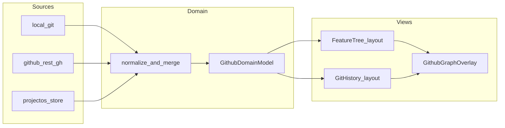
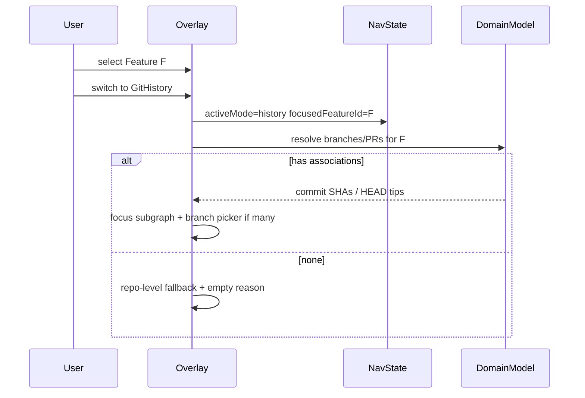

# GitHub Graph：Feature Tree + Git History Hybrid

**状态**：M1 in progress（T0/T1/T2/T3/T4/T5/T7/T8 已落地初版；Feature 持久化与详情面板后续）。  
**范围**：将现有 Workbench「分区树」GitHub Graph 升级为 **双模式混合图**——Feature Tree（工作逻辑结构）与 Git History（真实 commit 拓扑），共用一层领域模型与稳定身份，经类型化关系连接；同步策略与 AI-agent 扩展点一并规划。  
**产品定位一句话**：Feature Tree 回答「我们在建什么」；Git History 回答「代码怎么演化」；二者是同一项目的两种投影，不是两套互不相干的数据副本。

**权威交叉引用**：
- 现役实现与边界：[`GitHub-Compose-Hub-Dev-Plan.md`](./GitHub-Compose-Hub-Dev-Plan.md)（分区树浮窗已落地；明确「不是 commit Network Graph」）
- 认证：[`GitHub-Auth-Dev-Plan.md`](./GitHub-Auth-Dev-Plan.md)
- Live Graph / Agent×C4：[`Live-Graph-Agent-Observability-Dev-Plan.md`](./Live-Graph-Agent-Observability-Dev-Plan.md)（叠加层模式可类比；勿混入架构图）
- Agent 活动文字流：[`Agent-Flow-Activity-Dev-Plan.md`](./Agent-Flow-Activity-Dev-Plan.md)
- Worktree / Harness：[`Agent-Harness-Dev-Plan.md`](./Agent-Harness-Dev-Plan.md)
- Overlay 壳体：`GraphOverlayFrame`、`SessionGraphOverlay`、`LoopGraphOverlay`
- 故事图约定：`.projectos/features.json`（Epic→Feature→Step；纯仓契约薄、API 多 stub）

**锁定决策**（本计划）：
1. **一层领域模型、两种视图**——禁止 Feature Tree 与 Git History 各维护一份不一致的 GitHub 缓存。
2. **Hybrid graph**——Feature 父子保持层级；跨 Feature 依赖、Feature↔Issue/Branch/PR、commit 父子均为 **typed edges**，不塞进任意多父树。
3. **Feature 是 Project OS 一等实体**——可映射 GitHub Issue，但不必等于 Issue。
4. **不假设 1 Feature = 1 Branch = 1 PR**——允许多对多；无证据不猜 commit↔Feature。
5. **Git History 必须反映真实 Git 拓扑**——`parent` 来自 commit metadata / `git rev-list --parents`，禁止人造线性时间线冒充历史。
6. **可读性优先**——Issue/PR/CI/files 默认摘要、徽章、详情面板或 overlay，不全量常驻主画布。
7. **模式切换保上下文**——`focusedFeatureId` / `selectedCommitSha` / per-mode viewport。
8. **为 AI-agent 留扩展点**——本里程碑不要求完整 agent 活动可视化。
9. **复用现有壳体与交互**——`GraphOverlayFrame`、pan/zoom、tech tokens；不引入第二套图库除非证明现有方案不够用。
10. **安全回滚**——优先 `git revert`（新提交）；`reset --hard` + force-push 已存在于当前 overlay，须降级为高级/显式危险路径并与「安全回滚」文案分离。

**与现役计划的漂移（须在 M1 对齐产品）**：
- [`GitHub-Compose-Hub-Dev-Plan.md`](./GitHub-Compose-Hub-Dev-Plan.md) 曾写「本轮不做 force push / hard reset / 删分支」；当前 `GithubGraphOverlay` **已实现** rename / delete / hard rollback + force-with-lease。本升级计划 **保留**这些能力，但要求 UI 将 destructive reset 与 safe revert 明确区分。

---

## A. Executive Summary

### 将要建设什么

在现有 Workbench GitHub Graph 浮窗内增加 **Mode 切换**：

| 模式 | 回答 | 布局语义 |
|------|------|----------|
| **Feature Tree** | Epic/Feature 层级、负责人、关联 Issue/Branch/PR、依赖与状态 | 稳定层级树（可演进自 `layoutGithubGraphTree`） |
| **Git History** | Commit DAG、branch HEAD、PR/CI 叠加、文件变更详情 | 真实 parent 边的 DAG（建议 ELK / Session 式 layered 或专用 commit layout） |

共享：仓库身份、Branch/Commit/PR 规范化对象、同步状态、详情面板骨架、模式切换导航契约。

### 关键架构决策

| 决策 | 选择 | 理由（代码依据） |
|------|------|------------------|
| 视图壳体 | 继续 `GraphOverlayFrame` + `CanvasOverlay: 'github'` | 已与 Session/Loop 同壳；见 `GithubGraphOverlay.tsx`、`chatSessionStore.ts` |
| 领域存储 | 新 contract + `.projectos/github-graph/`（或等价）持久化 Project OS 侧 Feature/关联 | GitHub 事实不该写进 UI `parentByBranchName` |
| Commit 拓扑数据源 | **优先本地 git**（`rev-list --parents`）；REST `/commits` 作补充 | 今日 `git-context-service` 无 commit API；REST 仅 branches+PRs（`github-rest.ts`） |
| Feature 来源 | 新 `GithubFeature` 实体；可选桥接 `.projectos/features.json` / Issue | 现有 features 是故事图，非 Git 工作分区；契约薄 |
| C4 / ELK | Feature Tree **不**强制用 `layoutWithElk`；History DAG **可**借鉴 `layoutSessionGraph` | `computeTopologyLayout` **不存在**（仅 Live Graph 文档提及）；C4 形状勿复用 |
| 图库 | 默认继续自定义 SVG world（现 Github/Session 模式）；若 History 规模爆了再评估 React Flow | 避免无证据换栈 |

### 明确不在本计划范围（Out of scope）

- Overlay / Spatial Captures 内嵌完整双模式 Graph（仍仅 Locator；见 Compose Hub 计划）。
- References 仓上的 checkout / PR。
- 把 Feature Tree 画进 C4 架构图或 Live Execution overlay（可后续叠加，本计划不混层）。
- 完整 GitHub Issues 产品（MVP 仅可选映射字段 + 后续 REST）。
- 全量 CI Checks API 产品化（M2 overlay；M1 可缺省）。
- 完整 AI-agent×Feature 可视化（M3 扩展点 + 事件 schema）。
- 用假关系「填满」图以显得完整。

---

## B. Current Architecture Audit

### 已检查的关键路径（实勘）

| 区域 | 路径 | 结论 |
|------|------|------|
| Graph UI | `projectos/workbench/src/components/GithubGraph/GithubGraphOverlay.tsx` | 单体：加载、突变、pan/zoom、右键菜单；无 Feature/Commit 模式 |
| 模型/布局 | `.../GithubGraph/buildGithubGraphModel.ts` | 分区树；`layoutGithubGraphTree` 横向 L→R |
| 契约 | `projectos/contracts/github-graph.ts` | kinds: `default\|group\|branch\|pr\|worktree`；注释写明非 Network Graph |
| Workspace git | `projectos/contracts/workspace-git.ts` | status/branch/PR/mutation；无 commit |
| Git 服务 | `projectos/services/git-context-service.ts` | 分支突变齐全；**无** `git log` / parents / show |
| REST | `projectos/services/github-auth/github-rest.ts` | **仅** branches + open PRs + create PR |
| Auth | `projectos/services/github-auth/*`、`contracts/github-auth.ts` | Device Flow / loopback / gh；scope 含 `repo` |
| Overlay 壳 | `components/GraphOverlay/GraphOverlayFrame.tsx` | 可复用 |
| Session 布局 | `components/SessionGraph/layoutSessionGraph.ts` | ELK layered DOWN——History 可参考 |
| C4 布局 | `components/FunctionMap/c4/layoutWithElk.ts` | 架构图专用；**不要**当 Feature Tree 默认 |
| Compose Locator | `SpatialComposeHub/GithubBranchLocator.tsx`、`githubBranchTree.ts` | 分支定位；与 Graph 分界保留 |
| 打开态 | `state/chatSessionStore.ts` → `githubGraphOpen` | `CanvasOverlay += 'github'` |
| Worktree | `contracts/agent-worktree.ts`、`services/harness/worktree.ts` | 可挂 Feature/agent 后续关联 |
| Agent 事件 | `contracts/events.ts`、`file-timeline.ts` | 路径 + content sha256；**无** commitSha |
| 故事 Feature | `client/sample-projectos-fixtures/features.json` | Epic→Feature→Step；纯仓 API 多 stub |
| 既有 DevPlan 格式 | `docs/features/*-Dev-Plan.md` | 状态/范围/锁定/里程碑/数据流/不做/验收 |

### 可复用

- `GraphOverlayFrame` + shield insets、tech tokens、pan/zoom/selection 交互。
- 现有 git 突变：checkout / create / rename / delete / rollback / fetch / push / PR。
- OAuth token → HTTPS git 头 + REST。
- 乐观 `pending` 节点与 soft reload。
- Session ELK 布局模式（History DAG 候选）。
- Live Graph「叠加层」产品哲学（PR/CI 作 overlay，不写进核心拓扑）。

### 须修改

- `contracts/github-graph.ts`（或拆出 `github-graph-domain.ts`）：实体 + 关系 + 视图模型。
- `buildGithubGraphModel.ts` / Overlay：双模式、详情面板、模式切换状态。
- `git-context-service.ts` + `workspace-git` / API / IPC / transports：commit 列表与 parents、可选 diff-by-sha。
- `github-rest.ts`：按需扩展 commits / compare / checks / issues（分里程碑）。
- Compose Hub 文案与 DevPlan 漂移对齐（destructive ops）。

### 缺口（审计明确为缺失，非假设）

| 能力 | 状态 |
|------|------|
| `computeTopologyLayout` | **不存在**（文档名）；实际为 ELK / 自定义树 |
| Commit SHA / parent 边 | **无** |
| Feature 一等契约 + 持久化 API | **无**（仅故事图 JSON 约定） |
| GitHub Issue 实体 / REST | **无** |
| CI Check Run 实体 / REST | **无** |
| Feature↔Branch/PR 多对多存储 | **无**（仅 slash 命名约定） |
| Agent run → commitSha | **无** |
| 模式切换共享导航状态 | **无** |
| 持久化 `parentByBranchName` | **无**（会话内） |

### 测试惯例

- Vitest：`buildGithubGraphModel.test.ts`、`git-context-service.test.ts`、IPC 校验。
- 新域模型应同样用纯函数单测 + 临时 git bare 仓库集成测（已有 create/push 模式）。

---

## C. Architecture and Data Flow

### 三层

```text
┌──────────────────────────────────────────────────────────────┐
│  Layer A · Visualization                                     │
│  FeatureTreeView | GitHistoryView                            │
│  shared: GraphOverlayFrame, DetailPanel, ModeSwitch, Filters │
├──────────────────────────────────────────────────────────────┤
│  Layer B · Domain Model (Project OS)                         │
│  Repo, Feature, Issue?, Branch, Commit, PR, Check?, FileChange│
│  typed Relations + stable IDs                                │
├──────────────────────────────────────────────────────────────┤
│  Layer C · Adapter / Sync                                    │
│  git-context-service (local truth for commits/parents)       │
│  github-rest / gh (remote branches, PRs, later issues/checks)│
│  .projectos/github-graph/* (Feature + associations)          │
└──────────────────────────────────────────────────────────────┘
```

### 数据流（目标）



### 模式切换流



### 同步流（务实）

1. **Initial**：`fetch` + `listBranches` + `listPRs` + `rev-list`（有界，见任务）+ 读本地 Feature 文档。  
2. **Incremental**：打开 Graph / 手动 Refresh / 可选轮询；**无 webhook 基础设施则不强求 webhook**（审计未发现 GitHub webhook 服务）。  
3. **Idempotent merge**：按 GitHub node_id / SHA / PR number upsert。  
4. **Stale**：`lastSyncedAt` + UI chip；删除 branch 不删 commit 对象。

---

## D. Data Model and Relationship Specification

### 提议契约位置（proposed）

- `projectos/contracts/github-domain.ts` — 领域实体与关系（**新**）
- `projectos/contracts/github-graph-nav.ts` — 双模式导航状态（**新**）
- 演进 `projectos/contracts/github-graph.ts` — 视图投影节点（可保留 partition 兼容或标记 deprecated）
- 持久化（proposed）：`.projectos/github-graph/features.json`、`associations.json`、`sync-meta.json`

### 概念类型（名称可在实现时微调；语义锁定）

```ts
// conceptual — not committed code
type PosId = string; // Project OS stable id
type GithubNodeId = string; // GitHub node_id when known
type Sha = string; // full or abbreviated consistently (prefer full)

interface GithubRepoRef {
  posId: PosId;
  fullName: string; // owner/repo
  defaultBranch: string;
  remoteUrl?: string;
  lastSyncedAt?: string;
}

interface GithubFeature {
  id: PosId;
  title: string;
  description?: string;
  parentFeatureId?: PosId | null; // hierarchy only
  assigneeIds?: string[];
  status: "planned" | "active" | "blocked" | "done" | "archived";
  issueRef?: { number: number; url?: string; state?: string } | null;
  updatedAt?: string;
}

interface GithubBranchRef {
  name: string;
  headSha?: Sha | null;
  remote: boolean;
  upstream?: string;
  deleted?: boolean;
}

interface GithubCommit {
  sha: Sha;
  parentShas: Sha[]; // authoritative git parents
  message: string;
  authorName?: string;
  authoredAt?: string;
  changedFilesSummary?: { path: string; status: string; additions?: number; deletions?: number }[];
}

interface GithubPullRequestRef {
  number: number;
  title: string;
  url: string;
  headRef: string;
  baseRef: string;
  state: "open" | "closed" | "merged";
  headSha?: Sha;
}

type RelationKind =
  | "feature-parent"      // Feature → Feature (hierarchy)
  | "feature-depends"     // Feature → Feature (graph edge)
  | "feature-tracked-by"  // Feature → Issue
  | "feature-implemented-by" // Feature → Branch
  | "feature-reviewed-by" // Feature → PR
  | "commit-parent"       // Commit → Commit (git fact)
  | "branch-head"         // Branch → Commit
  | "pr-head" | "pr-base" // PR → Branch
  | "pr-contains-commit"  // derived / optional
  | "validated-by"        // Commit|PR → Check (later)
  | "agent-touched";      // AgentSession → Feature|Commit|File (extension)
```

### 来源权威

| 关系 | 权威来源 |
|------|----------|
| `commit-parent`, branch HEAD SHA | **Git / GitHub** |
| PR head/base/state | **GitHub** |
| Feature 层级、depends、用户映射 | **Project OS** |
| Feature progress 汇总、关联计数 | **Derived** |
| slash-path `group` | **Derived UI**（可继续作无 Feature 时的退路） |

### 多对多与陈旧

- associations 表：`{ featureId, kind, targetType, targetKey, createdAt, source: "user"|"import"|"heuristic" }`  
- 删除 remote branch：标记 `Branch.deleted`，保留 commits/PR 历史与 Feature 关联（或标 stale）。  
- 重名 branch：不以 name 为永久 ID；内部可用 `repoId + name + createdEpoch` 或 GitHub API branch commit URL；HEAD 以 SHA 为准。  
- 启发式自动关联（同名 issue/branch）必须标 `source: heuristic`，可一键撤销。

### 迁移

- 现有 slash `group` 树：M1 可读为「未认领分区」；提供「提升为 Feature」动作（M2）。  
- 不破坏现有 checkout/create IPC。

---

## E. Detailed Implementation Tasks

### T0 — Align product docs & safety copy
- **Objective**：对齐 Compose Hub 计划与现行 destructive ops；区分 revert vs reset。  
- **Modify**：`docs/features/GitHub-Compose-Hub-Dev-Plan.md`（状态/不做条款）、`GithubGraphOverlay` 文案键。  
- **Acceptance**：文档不再声称「未做 delete/reset」；UI 上 rollback 标明 hard reset。  
- **Tests**：i18n key 存在性（或 snapshot）。  
- **Risk**：用户已依赖 hard reset——保留但降级文案。

### T1 — Domain contracts
- **Objective**：落地 `GithubFeature`、`GithubCommit`、`Relation`、`GithubDomainModel` Zod schemas。  
- **Create (proposed)**：`projectos/contracts/github-domain.ts`、`github-domain.test.ts`。  
- **Deps**：无。  
- **Acceptance**：Zod round-trip；关系 kind 枚举完整；与 `workspace-git` 不重复冲突。  
- **Tests**：unit parse/reject。

### T2 — Nav / mode state contract
- **Objective**：`activeMode`, `focusedFeatureId`, `selectedCommitSha`, `focusedBranchRef`, `expandedFeatureIds`, `visibleOverlays`, per-mode viewport。  
- **Create (proposed)**：`projectos/contracts/github-graph-nav.ts`。  
- **Modify**：`GithubGraphOverlay.tsx` 本地 state 对齐（先内存，后可 persist）。  
- **Acceptance**：模式切换不丢失对侧 viewport；删除实体时 selection 清空并提示。  
- **Tests**：纯函数 reducer 测（proposed `githubGraphNav.ts`）。

### T3 — Local commit ancestry API
- **Objective**：`listGitCommits({ max, branches?, since? })` 返回 sha/parents/message/author。  
- **Modify**：`git-context-service.ts`、`workspace-git.ts`、`api.ts`、`project-os-local-api.ts`、IPC signatures、`IpcTransport`、`NotConnectedTransport`、`real-project-os-api-client.ts`。  
- **Acceptance**：含 merge commit（`parentShas.length > 1`）；有界（默认 N≤500 或按 tip 深度）；非 git 仓返回明确错误。  
- **Tests**：bare+merge fixture（仿现有 push 测试）。  
- **Risk**：大仓性能——强制 cap + 按 focused tips 增量。

### T4 — Commit file summary API
- **Objective**：`getGitCommitShow(sha)` → files + optional patch trunc。  
- **Modify**：同上服务栈。  
- **Acceptance**：rename/binary/缺失 sha 有明确状态；大 diff truncate 与 `getWorkingTreeDiff` 同策略。  
- **Tests**：unit on temp repo。

### T5 — Domain assembler
- **Objective**：从 branches/PRs/commits/features/associations 组装不可变 `GithubDomainModel`。  
- **Create (proposed)**：`projectos/workbench/src/components/GithubGraph/assembleGithubDomainModel.ts`（或 services 层）。  
- **Acceptance**：同一输入两次结果稳定；branch 删除不影响 commit map。  
- **Tests**：fixtures with shared ancestor + two tips。

### T6 — Feature Tree view model + layout
- **Objective**：Repo → Feature 层级；Issue/Branch/PR 为徽章计数；依赖边可选叠加。  
- **Modify**：拆分 `buildGithubGraphModel` 或旁路 `buildFeatureTreeProjection.ts`；复用/演进 `layoutGithubGraphTree`。  
- **Acceptance**：无 Feature 时回退现行 slash partition（兼容）；展开/折叠（新增 `expandedFeatureIds`）。  
- **Tests**：hierarchy + badge counts。  
- **Note**：拖拽改父级 **默认关闭**；若做，须确认+校验（见原则）。

### T7 — Git History view model + DAG layout
- **Objective**：commit 节点 + parent 边；branch HEAD 标记；PR/CI 默认关闭的 overlay。  
- **Create (proposed)**：`layoutGithubCommitDag.ts`（ELK 参考 `layoutSessionGraph` **或** 增量自研；选型在实现前用 ≤200 commits fixture 验证）。  
- **Acceptance**：菱形合并可见；删 branch 后历史仍在；缩放可读。  
- **Tests**：parents wiring；layout 无重叠冒烟。  
- **Risk**：若 ELK 正交边不适合 commit，允许简单贝塞尔 + 分层 y=time。

### T8 — Dual-mode shell UI
- **Objective**：Mode toggle、共享 header（repo/dirty/sync）、详情面板骨架。  
- **Modify**：`GithubGraphOverlay.tsx`、CSS、i18n。  
- **Acceptance**：切换模式保持 `focusedFeatureId`/`selectedCommitSha` 契约；空/加载/错误态齐全。  
- **Tests**：组件级可选；至少 manual checklist。

### T9 — Detail panel：commit + files
- **Objective**：选中 commit 显示 metadata、parents、files；打开 diff（截断）。  
- **Modify**：Overlay 或 `GithubGraphDetailPanel.tsx`（proposed）。  
- **Acceptance**：与 T4 对接；权限/缺失 patch 文案。  
- **Tests**：render with fixture model。

### T10 — Mode switch resolvers
- **Objective**：Feature→History / History→Feature 解析 0/1/多 关联。  
- **Create (proposed)**：`resolveGithubGraphFocus.ts`。  
- **Acceptance**：多分支弹出选择器；无关联显示原因+仓库回退；不猜测。  
- **Tests**：表格驱动 0/1/N。

### T11 — Feature persistence + CRUD (MVP)
- **Objective**：读写 `.projectos/github-graph/features.json`；创建/重命名/再父级（显式）。  
- **Modify**：`workspace-store` 或新 service；local-api methods。  
- **Acceptance**：重启后 Feature 仍在；与 GitHub 删除无关。  
- **Tests**：fs temp workspace。  
- **Gap flag**：与故事 `features.json` 桥接标为 **optional / M2**。

### T12 — Associations M:N
- **Objective**：Feature↔Branch、Feature↔PR 关联/取消；UI 管理。  
- **Deps**：T1, T11。  
- **Acceptance**：多对多；stale 目标显示；启发式标 source。  
- **Tests**：association merge + dedupe。

### T13 — REST extensions (Issues / Checks / Commits as needed)
- **Objective**：按需扩展 `github-rest.ts`；尊重分页与 403。  
- **Acceptance**：无 token 时降级；rate limit 可观测。  
- **Tests**：mock fetch。  
- **Uncertainty**：Checks API 权限因 repo 而异——M2 功能开关。

### T14 — Sync meta + stale UX
- **Objective**：`lastSyncedAt`、失败重试、部分成功。  
- **Acceptance**：header chip；Refresh 幂等。  
- **Tests**：duplicate event merge。

### T15 — Safe revert path
- **Objective**：`git revert <sha>`（新提交）+ 确认；与现 hard rollback 分菜单。  
- **Modify**：`git-context-service`、overlay 菜单。  
- **Acceptance**：共享历史上不默认 force-push；冲突时中止并提示。  
- **Tests**：revert creates new commit。  
- **If blocked**：推到 M3，不引入不安全捷径。

### T16 — Agent extension point (schema only)
- **Objective**：`agent-touched` 关系 + 事件可选字段 `commitSha?` / `featureId?` 文档化。  
- **Modify**：`contracts/events.ts` 或旁路 schema（additive）；Live Graph / file-timeline 文档交叉引用。  
- **Acceptance**：旧事件仍合法；新字段可选。  
- **Tests**：zod optional.  
- **Out**：完整可视化。

### T17 — Performance & regression
- **Objective**：commit cap、虚拟化评估、既有 partition 行为回归。  
- **Acceptance**：≤200 commits 交互流畅（目标）；现有 create/checkout 测试全绿。  
- **Tests**：扩展 `buildGithubGraphModel.test.ts` + git service。

---

## F. Milestones

### Milestone 1 — Core Dual-Mode Foundation
**Tasks**：T0, T1, T2, T3, T4, T5, T6, T7, T8, T9, T10（最小关联：仅 slash/显式 parent 提示，可无持久 Feature）。  
**交付**：能在 Feature Tree（兼容分区）与 Git History（真 parents）间切换；commit 详情+文件列表；上下文切换 0/1/N 行为确定。  
**为何先本地 commit API**：REST 无 commits；本地 git 已是工作区真相源。

### Milestone 2 — GitHub Relationships and Synchronization
**Tasks**：T11–T14, 完善 T10 用持久关联；可选 Issues。  
**交付**：Feature CRUD、M:N 关联、同步陈旧指示、PR/CI overlays（CI 可开关）。

### Milestone 3 — Advanced Workflow Integration
**Tasks**：T15–T17、启发式关联发现、agent-touched 消费（只读徽章）、性能。  
**交付**：安全 revert；agent 扩展点可用；大仓可用性。

**顺序说明**：先 History 数据面（今日最大缺口），Feature 持久化紧随其后；不把 C4/Live Graph 重写绑进 M1。

---

## G. Testing Strategy

| 层 | 内容 |
|----|------|
| Unit | 关系解析、ID、assemblers、nav reducer、focus resolvers |
| Git fixtures | merge commits、diverged tips、shared ancestors、force-push HEAD 变化、branch delete |
| Feature Tree | 层级、依赖边、无 Issue/多 branch 徽章 |
| Associations | M:N dedupe、stale、heuristic flag |
| Mode switch | 0/1/N branches/PRs/Features |
| Sync | 分页 mock、403、重复事件、乱序 upsert |
| UI | Overlay 空/加载/错误；destructive confirm |
| Regression | 既有 `git-context-service` / `buildGithubGraphModel` / Compose Locator；**不改** C4 `layoutWithElk` 行为 |

---

## H. Risks and Technical Decisions

| 风险 | 缓解 | 备选 |
|------|------|------|
| 大仓 commit 爆炸 | 有界 `rev-list`、按 tip 增量、虚拟化 | 仅显示 focused Feature 子图 |
| API 限流 | 本地 git 优先；REST 缓存+Backoff | `gh` CLI 降级 |
| Feature↔commit 归因模糊 | 禁止无证据猜测；只走 Branch/PR 显式链 | 用户手动关联 |
| 状态双份 | 单一 `GithubDomainModel` + 投影 | — |
| 与故事 features.json 混淆 | 分文件/分契约；桥接显式 | 暂不桥接 |
| Destructive reset 已上线 | T0 文案+确认；推 safe revert | — |
| DAG 布局选型 | T7 前 spike验证 | 时间分层自研 |
| `computeTopologyLayout` 文档幻影 | 本计划不引用为实现 | 实现时用真实函数名 |
| Webhook 缺失 | 轮询+手动 Refresh | 未来 desktop webhook（另计划） |

**待人确认**：
1. Feature 是否必须桥接 Function Map / `features.json`，还是 GitHub Graph 独立工作项实体？（默认：**独立**，可选桥接）  
2. Hard reset 是否保留为高级菜单？（默认：**保留但降级**）  
3. History 默认 commit 上限（建议 **200** tips-first）。

---

## I. Acceptance Criteria（功能完成时）

1. 用户可在同一浮窗切换 Feature Tree ↔ Git History，且共享仓库身份。  
2. Feature Tree 展示可持久（M2）的 Feature 层级；无 Feature 时兼容现行 slash 分区树。  
3. Git History 中 merge/分叉/共享祖先来自真实 parent SHAs，非人造线性列表。  
4. 选中 commit 可查看文件变更摘要；大 diff/二进制有降级说明。  
5. Feature→History：0/1/多关联行为符合 T10；无猜测边。  
6. History→Feature：对称解析；多匹配可挑选。  
7. 删除 remote branch 不擦除已同步 commit/PR 领域对象。  
8. 同步失败/陈旧在 UI 可见；Refresh 可恢复。  
9. Destructive reset 与 safe revert（若已交付）文案与确认分离。  
10. 既有 checkout/create/PR/worktree 徽章路径不回归；C4 Graph 无强制改动。  
11. Agent 扩展字段向前兼容（T16）。  
12. 自动化测试覆盖 parents、associations、focus resolvers、git mutation 回归。

---

## J. Recommended Implementation Order

```text
T0 ──► T1 ──► T2
         │
         ├──► T3 ──► T4 ──► T5 ──► T7 ──► T9
         │                      │
         └──► T6 ───────────────┴──► T8 ──► T10
                                              │
                         M2: T11 ──► T12 ──► T13 ──► T14
                                              │
                         M3: T15 ──► T16 ──► T17
```

**可并行**：T3∥T6（数据 vs 树投影）；T4∥T8；T11∥T13（持久化 vs REST）。  
**不可并行乱序**：T5 依赖 T1+T3；T10 依赖 T5+T8；T12 依赖 T11。

---

## 实现对照表（复用 / 修改 / 新建）

| 类别 | 项 |
|------|-----|
| **Reuse** | `GraphOverlayFrame`, pan/zoom pattern, tech tokens, OAuth+token git auth, branch/PR IPC, `GithubBranchLocator`, Session ELK as reference, Live Graph overlay philosophy |
| **Modify** | `GithubGraphOverlay.tsx`, `buildGithubGraphModel.ts`, `contracts/github-graph.ts`, `git-context-service.ts`, `workspace-git.ts`, `api.ts`, IPC validation, transports, clients, Compose Hub DevPlan safety wording, i18n |
| **Create (proposed)** | `contracts/github-domain.ts`, `contracts/github-graph-nav.ts`, `assembleGithubDomainModel.ts`, `buildFeatureTreeProjection.ts`, `layoutGithubCommitDag.ts`, `resolveGithubGraphFocus.ts`, `GithubGraphDetailPanel.tsx`, `.projectos/github-graph/*`, local-api persist helpers |
| **Uncertain / verify** | ELK vs custom for commit DAG; Feature↔故事图是否桥接; Checks API 可用性; commit cap 默认值 |

---

## 明确不做（本升级计划）

- 在 Overlay/Captures 画完整双模式 Graph。  
- 把 Feature/commit 写进 C4 节点类型。  
- 无证据的 Feature↔commit 边。  
- 用多父「树」冒充依赖图。  
- 替换整体图基础设施为未经验证的新库。  
- M1 做完整 Issues/CI/agent 时间线产品。  
- 静默改写共享历史（默认路径）。

---

## 验收（计划层）

- [ ] 评审通过本 DevPlan（含待确认三项）。  
- [ ] M1 任务可被编码代理按 T0→T10 顺序执行且每步有测试。  
- [ ] 与 [`GitHub-Compose-Hub-Dev-Plan.md`](./GitHub-Compose-Hub-Dev-Plan.md) 破坏性操作条款已对齐。  

**下一步**：人工确认 H 节三项决策后，从 **T0 + T1 + T3** 开工（文档对齐 + 契约 + commit ancestry）。
