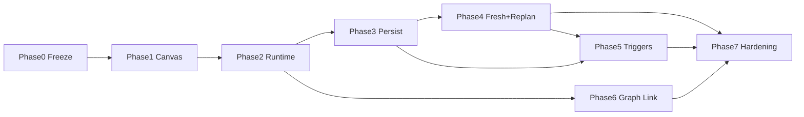
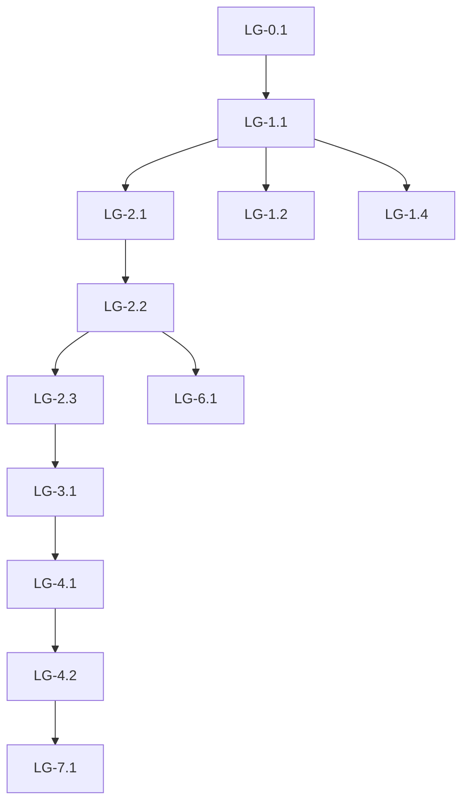
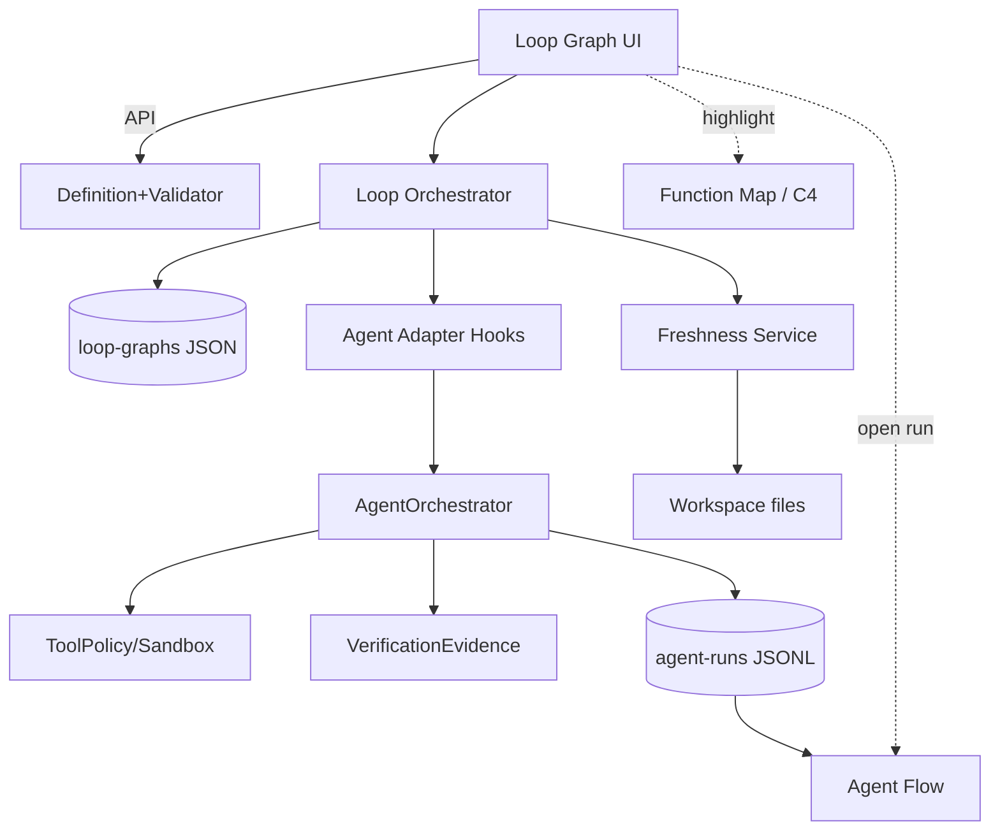

# Loops Graph Workflow Studio：可视化 AI 开发闭环编排器

**状态**：Design freeze draft（2026-10-20）。**仅文档**；本计划不授权开始实现切片，直到 Phase 0 检查清单关闭。  
**范围**：在复用现有 Agent Runtime / Harness / Verification / Function Map 的前提下，把已有 Loop Graph 提升为可定义、可批准、可运行、可恢复、可重规划、可与 C4 / Agent Flow / Session Graph 联动的工作流系统。  
**产品定位一句话**：Loops Graph 是面向代码 Agent 的可视化闭环编排器——定义可批准工作流，执行绑定真实 AgentRun 与 VerificationEvidence；不是通用 iPaaS，也不是第二张 C4。  
**与已有计划的关系**：

| 文档 | 关系 |
|------|------|
| [`backend/Planning-Orchestration-Dev-Plan.md`](./backend/Planning-Orchestration-Dev-Plan.md) | **已落地底座**：P-0–P-3（规格冻结、implement=AgentRun、verify=证据、HITL）。本计划在其上扩展产品与可靠性，不重做 P-0–P-3。 |
| [`backend/Backend-Dev-Plan.md`](./backend/Backend-Dev-Plan.md) | 后端索引；Loop = 工作流定义，Run = 一次执行。 |
| [`Live-Graph-Agent-Observability-Dev-Plan.md`](./Live-Graph-Agent-Observability-Dev-Plan.md) | C4 上的执行投影；与 Loop 共享诚实事件源。 |
| [`Agent-Flow-Activity-Dev-Plan.md`](./Agent-Flow-Activity-Dev-Plan.md) | 文字活动流 / 「Sessions」执行轨迹面（Agent Flow）。 |
| [`Agent-Harness-Dev-Plan.md`](./Agent-Harness-Dev-Plan.md) | ToolPolicy、预算、中断/续跑；Loop 暂停必须打到 harness。 |
| [`backend/Verification-Eval-Dev-Plan.md`](./backend/Verification-Eval-Dev-Plan.md) | `VerificationEvidence`；verify 节点唯一通过依据。 |
| [`backend/Session-State-Dev-Plan.md`](./backend/Session-State-Dev-Plan.md) | `interrupted` / 续跑语义。 |
| [`backend/Security-Governance-Dev-Plan.md`](./backend/Security-Governance-Dev-Plan.md) | 审批审计；重规划不得扩大权限。 |

**命名澄清（调研结论）**：产品文案中的「Sessions Graph」在代码库中**不是**独立执行图产品名。实际存在：

1. **Session Graph**（`workbench/.../SessionGraph/`）——聊天会话空间布局。  
2. **Agent Flow**（`AgentFlowPanel` + `AgentRunEvent`）——Agent 工具调用与步骤轨迹。  
3. **Loop Graph**（本计划）——工作流定义与实例控制。  
4. **C4 / Function Map**——架构与写授权叶子。  

本计划把「Sessions Graph」映射为 **Agent Flow +（可选）Session Graph 链接**，避免再造第四套矛盾状态。

---

## 1. Executive Summary

Project OS 已具备 Loop Graph 的**最小可运行闭环**：意图画布 → 启发式编译 → 批准 `LoopSpec` → `LoopInstance` 步进 → `implement`/`fix` 附着叶子 `AgentRun` → `verify` 只认证据 → `decide`/HITL → 至多一条 feedback 回环。持久化在 `.projectos/loop-graphs/`。

缺口集中在**产品工作流工作室**与**可靠性语义**，而不是「从零写编排引擎」：

- 画布缺 Palette / 侧栏 Inspector / Preset；配置仍偏节点卡片。  
- 暂停/取消未强制下传到 `pauseAgentRun` / `cancelAgentRun`。  
- 无 Context Baseline / Fresh·Stale；无结构化重规划提案；无参数化/事件触发启动。  
- 拓扑仍限制为**单链 depends + 至多一条 feedback**；无并行调度（与 Backend 锁定一致）。  
- 节点状态枚举与产品目标态（Ready / Verifying / Stale…）未对齐。

本 DevPlan 将演进路径定为：先冻结状态机与副作用语义 → 补齐双层画布与真实 pause → 检查点与去重 → Fresh/Stale 与重规划提案 → 参数化与内部事件触发 → Graph 联动 → 可靠性验收。全程**禁止**另起一套 Agent Runtime；节点内执行继续走 `AgentOrchestrator` + Harness。

---

## 2. 产品目标与非目标

### 2.1 目标

1. 用户可手动或经 AI 辅助创建/编辑工作流，并在应用前预览与修改。  
2. 定义版本与运行实例分离；运行中规格不可静默改写。  
3. 节点是任务边界；节点内多轮工具调用属 Agent Runtime / Agent Flow。  
4. 完成态必须可指向 `agentRunId` 或 `evidenceId`。  
5. 有限重试受节点策略与全局预算双重约束。  
6. 暂停/取消/恢复有真实运行时语义。  
7. 重规划以提案形式出现，默认需审批。  
8. 与 C4（范围/文件）、Agent Flow（轨迹）、Session Graph（会话链接）、Live Graph（空间投影）展示同一运行事实。

### 2.2 非目标（MVP 明确延期）

| 非目标 | 原因 |
|--------|------|
| 通用 SaaS/HTTP 集成市场、credentials 商店 | 产品是 AI 开发闭环，不是 n8n 克隆 |
| Route ② 模型自由 tool loop | Backend / Harness 锁定关闭 |
| 多 Agent 并行调度 / 自动 worktree 并行 | Backend Phase 4 前不做；无冲突检测 |
| 全仓库依赖追踪 / 通用 GraphRAG | 成本过高；MVP 用关键路径指纹 |
| 外部 Webhook / 任意 cron 平台 | 事件触发仅限 Project OS 内部事件 |
| 把 Loop 节点持久化进 C4 拓扑 | 三层分离不变量 |
| 用 Plan Markdown 代替 LoopSpec 执行 | Planning 已明确 |
| 恰好一次（exactly-once）分布式效果 | 本地单用户；目标是安全阻塞 + 幂等键/查询，不是分布式事务 |

---

## 3. 已确认的产品决策（基线，不得擅自改）

| ID | 决策 | 落地含义 |
|----|------|----------|
| D1 | 混合规划 | 节点内策略可调；目标/验收/权限/预算不可静默改；重规划走提案 |
| D2 | 节点 = 任务边界 | 调度器管依赖/验收/重试/审批；Runtime 管节点内推理与工具 |
| D3 | 双层画布 | 画布简洁；详情在侧栏 Inspector |
| D4 | 三种启动统一为 Workflow Run | 手动 / 参数化 / 事件 → 同一 `LoopInstance` 创建路径与审计 |
| D5 | 定义版本固定；项目事实可实时读 | `specVersion` 冻结；文件/Git/测试可读；关键边界做 freshness |
| D6 | 有限自动重试 | 工具级 vs 节点级；策略化，非散落常量 |
| D7 | 非幂等副作用保护 | 不明结果 → Blocked，不盲目重试 |
| D8 | 状态与有效性分离 | 执行状态 ≠ Fresh/Stale |
| D9 | Graph 职责边界 | C4 / Loop / Agent Flow / Runtime 不维护矛盾事实 |

---

## 4. 当前代码库调研结果

### 4.1 技术栈与组织（证据）

| 层 | 证据 |
|----|------|
| 前端 | Vite + React 18 + Zustand；Loop UI：`workbench/src/components/LoopGraph/*`、`state/loopGraphStore.ts`（`LoopPhase = draw \| review \| run`） |
| 图编辑 | **自研** canvas（非 React Flow）；`LoopGraphOverlay.tsx` + `loopEdgeRouting.ts` |
| 契约 | `contracts/loop-graph.ts`（IntentGraph / LoopSpec / LoopInstance / 拓扑校验） |
| 服务 | `loop-graph-service.ts`（FS CRUD）、`loop-graph-compiler.ts`（启发式编译）、`loop-runtime-service.ts`（`stepLoopInstance`）、`loop-execution.ts`（叶子绑定 + hooks）、`loop-goal-authoring-service.ts` / `loop-graph-edit-service.ts` |
| API | `contracts/api.ts` Loop 方法簇；实现 `project-os-local-api.ts`（含 `loopExecutionHooks` / `settleLoopRuns`） |
| Agent Runtime | `services/agent-orchestrator/index.ts`（`createRun` / `startRun` / `pauseRun` / `cancelRun` / `continueInterruptedRun`） |
| Harness | `services/harness/tool-policy.ts`、`resume-policy.ts`、shell-sandbox、audit |
| 事件 | `contracts/events.ts` → `streamAgentRun` → `handleRunEvent.ts` → Agent Flow |
| 验证 | `contracts/verification-evidence.ts`、`services/verification-evidence.ts`；`passed` 仅命令全绿 |
| 持久化 | 工作区 `.projectos/`：`loop-graphs/`、`agent-runs/*.jsonl`、`graph.json`、`chat-sessions/`（`workspace-store.ts` 定义 root） |
| 测试 | Vitest：`loop-runtime-service.test.ts`、`loop-graph*.test.ts`、UI 静态 markup 测试 |

### 4.2 能力清单

| 能力 | 状态 | 证据摘要 |
|------|------|----------|
| C4 / Function Map | **已实现** | `structure-graph-*`、`graph.json`、`fileIndex` / `linkedFiles` |
| Session Graph（会话图） | **已实现** | `SessionGraphOverlay.tsx`、`chat-session-service.ts` |
| Agent Flow（执行轨迹） | **已实现** | `AgentFlowPanel`、`AgentRunEvent`、JSONL |
| AI Chat / refine / confirm | **已实现** | `askAgent` / `refinePrompt` / `confirmExecution` |
| Agent Runtime + ToolPolicy | **已实现** | Orchestrator + harness；写走事务 apply |
| Loop 画布编辑 / 编译 / 批准 / 步进 | **部分实现** | Overlay + compile + approve + step；无 Inspector/Palette/Preset |
| implement → 真 AgentRun | **已实现** | `stepImplementNode` + `loopExecutionHooks.startAgentRun` + `settleLoopRuns` |
| verify → 证据 | **已实现** | `stepVerifyNode`；`not_run` → HITL |
| HITL / feedback 回环 | **部分实现** | `resolveLoopHitl`；至多 1 条 feedback；`maxRounds` |
| 暂停 Loop | **部分 / 语义不足** | `pauseLoopInstance` 只改实例状态，**未**调用 `pauseAgentRun`（`project-os-local-api.ts` ~5645） |
| 取消 Loop | **未发现独立 API** | 在已检查 API 中未见 `cancelLoopInstance`；Agent 侧有 `cancelAgentRun` |
| Fresh/Stale / Context Baseline | **未实现** | 在已检查 Loop/Runtime 范围内未发现 |
| 结构化重规划提案 | **部分** | `attachPendingSpecDraft` → `pendingCompile`；缺差异/成本/复用字段 |
| 参数化启动 / 事件触发 | **未实现** | 仅手动 `startLoopInstance` |
| 并行节点调度 | **未实现（刻意）** | `hasInFlightWork` 拒绝第二 Run；拓扑 outdegree≤1 |
| 长任务后台调度器（脱离 API 请求） | **部分** | `settleLoopRuns` 在 API 调用内轮询至多 6 次；无独立 worker 循环 |
| 通用条件分支 / Start·End 节点类型 | **未实现** | 角色为 `implement\|verify\|fix\|decide\|unknown`，非 Start/Condition 类型系统 |

### 4.3 关键调用链（证据）

**作者：目标 → 图**

```text
LoopGoalComposer / sendLoopAuthoringTurn
  → loop-goal-authoring-service / loop-graph-edit-service（启发式）
  → upsertLoopGraph → .projectos/loop-graphs/{id}.json
```

**编译与批准**

```text
compileLoopGraph → compileIntentGraphHeuristic → pendingCompile
approveLoopSpec → approvedSpecs[] + validateLoopSpecTopology
```

**运行**

```text
startLoopInstance
  → create LoopInstance (specVersion 冻结)
  → stepLoopInstance
      implement/fix → LoopExecutionHooks.startAgentRun
        → orchestrator.createRun (leaf-file scope)
      → settleLoopRuns → orchestrator.startRun
      → poll readRun；complete+applySucceeded → advanceCursor
      verify → readEvidence；passed → advance；failed → feedback 或 replan/HITL
      decide → awaiting_hitl → resolveLoopHitl
```

**Agent 事件 → UI**

```text
orchestrator.persistEvent → .projectos/agent-runs/{runId}.jsonl
  → streamAgentRun → handleRunEvent → Agent Flow / Live Overlay
LoopInstance.events 另存在 loop 文档内（含 agentRunId / evidenceId）
```

**写范围（不变量）**

```text
resolveLoopLeafWriteScope(功能图叶子, featureNodeId?)
  → 零或歧义叶子 → LOOP_FILES_NOT_ATTACHED
goal 文案不得解析写路径（loop-execution.ts 注释与实现）
```

### 4.4 可复用 vs 缺口（对 DevPlan 的影响）

| 复用 | 缺口 → 本计划任务 |
|------|-------------------|
| `LoopSpec`/`LoopInstance` 分离 | 扩展状态枚举与 Fresh/Stale 字段（契约演进） |
| `LoopExecutionHooks` 适配器模式 | 强化 pause/cancel 下传、副作用记录 |
| Orchestrator + VerificationEvidence | 禁止平行 Runtime |
| Agent Flow 事件模型 | Loop 节点 Inspector「打开关联 Run」 |
| Function Map 叶子绑定 | UI 显式绑定 + 多叶子失败文案 |
| `pendingCompile` | 升级为 `ReplanProposal` |
| FS 文档存储 | 保留；增加 checkpoint/idempotency 子结构，不引入新 DB |

---

## 5. 现状架构与目标架构

### 5.1 现状

```text
┌──────────────┐   draft    ┌─────────────┐  approve  ┌──────────┐
│ IntentGraph  │ ─────────► │ LoopSpec*   │ ────────► │ Instance │
│ (UI canvas)  │  compile   │ pending/ok  │           │ cursor   │
└──────────────┘            └─────────────┘           └────┬─────┘
                                                           │ hooks
                                              ┌────────────▼────────────┐
                                              │ AgentOrchestrator Run   │
                                              │ + VerificationEvidence  │
                                              └─────────────────────────┘
```

限制：线性 depends；单活跃实例；单 in-flight Run；pause 偏 UI；无 freshness。

### 5.2 目标（同进程模块，非微服务）

```text
┌─────────────────────────────────────────────────────────────────┐
│ Graph UI Integration                                            │
│ Palette · Canvas · Inspector · Run History · Replan Diff · HITL │
└────────────────────────────▲────────────────────────────────────┘
                             │ API (ProjectOSApi)
┌────────────────────────────┴────────────────────────────────────┐
│ Workflow Definition + Validator                                 │
│ IntentGraph → LoopSpec versions · topology · budgets · presets  │
├─────────────────────────────────────────────────────────────────┤
│ Workflow Orchestrator (evolve loop-runtime-service)             │
│ schedule · state machine · retry · checkpoint · replan gate     │
├───────────────┬─────────────────────────┬───────────────────────┤
│ Agent Adapter │ Context / Freshness     │ Execution Store       │
│ (hooks++)     │ (baseline · stale)      │ (.projectos/loop-     │
│               │                         │  graphs + agent-runs  │
│               │                         │  + audit)             │
└───────┬───────┴────────────┬────────────┴───────────────────────┘
        │                    │
        ▼                    ▼
 AgentOrchestrator      Function Map / C4
 Harness ToolPolicy     Live Overlay (read)
 VerificationEvidence   Agent Flow (read)
```

**Orchestrator 不负责**：模型推理、自由选工具、伪造完成、改写已批准权限。

---

## 6. 模块职责与接口边界

| 模块 | 职责 | 主要落点（现有 / 演进） | 不做 |
|------|------|------------------------|------|
| Workflow Definition | 节点/边/版本/模板/参数 Schema | `contracts/loop-graph.ts`、`loop-graph-service.ts` | 执行副作用 |
| Workflow Validator | 静态拓扑、预算字段、入口出口 | `validateLoopSpecTopology`、`getIntentGraphCompileIssues` | 运行时文件冲突裁决 |
| Workflow Orchestrator | 调度、状态机、重试、检查点、重规划门闩 | `loop-runtime-service.ts`、`settleLoopRuns` | 替代 Agent 推理 |
| Agent Adapter | 节点 → Run；权限/预算/取消信号 | `loop-execution.ts`、`loopExecutionHooks` | 直接写盘绕过 apply |
| Context / Freshness | Baseline、关键路径指纹、Stale | **新增服务模块（待命名）**，旁路挂 Orchestrator | 全仓依赖图 |
| Execution Store | 定义/实例/事件/检查点/审批/提案 | loop JSON + agent-runs JSONL + harness audit | 新数据库 |
| Graph UI | 双层交互、历史、联动 | `LoopGraph/*`、`loopGraphStore.ts` | 作为唯一状态源 |

### 6.1 建议对外契约演进（原则）

- 保持 `ProjectOSApi` Loop 方法族；新增而非破坏。  
- 候选新增（Phase 内落地时再定精确签名）：`cancelLoopInstance`、`getLoopReplanProposal`、`applyLoopReplan`、`startLoopInstanceWithParams`、`listLoopPresets`。  
- `LoopInstance` 扩展：`nodeStates[]`、`freshness`、`checkpoint`、`budgetUsage`、`idempotencyKey`（可选）。  
- **兼容**：旧文档 `normalizeLoopGraphDocument` 必须继续可读。

---

## 7. 核心数据模型（草案）

在现有 Zod 模型上演进，不另起一套「Workflow」名词替换（产品可称 Workflow Run = `LoopInstance`）。

```text
LoopGraphDocument
  draft: IntentGraph
  approvedSpecs: LoopSpec[]          // 定义版本
  instances: LoopInstance[]          // 运行
  pendingCompile? / pendingReplan?   // 待批提案
  presets meta?                      // 后期

LoopSpec
  nodes[] role ∈ implement|verify|fix|decide|(日后 condition 映射)
  edges[] kind ∈ depends|feedback|(日后 conditional)
  acceptance / retryPolicy / stopPolicy / permissions
  inputParams?                       // Phase 5
  budgets: tokens / wallClock / nodeRepairMax

LoopInstance (= Workflow Run)
  specVersion                        // 冻结
  status                             // 见 §8
  cursorNodeId / round / attemptCounts
  activeRunId / featureNodeId
  nodeRecords[]                      // per-node status + freshness + IO refs
  events[]                           // LoopInstanceEvent
  checkpoint?
  launch: { kind: manual|params|event, params?, eventId? }
  budgetUsage?
```

**MVP 节点语义映射（相对产品「Start/Condition/…」）**

| 产品概念 | MVP 映射 | 说明 |
|----------|----------|------|
| Start / Input | depends 链唯一入度 0 节点 | 不新增类型；参数挂在 Instance.launch |
| Task / Agent | `implement` / `fix` | 内含多轮 Runtime |
| Verify | `verify` | 只读证据 |
| Approval | `decide` + permissions.requiresApproval | HITL |
| Condition | **延期**或弱化为 edge.`when` 字符串（不执行表达式引擎） | 避免通用表达式 |
| End / Output | 无出边 depends 节点完成 → instance complete | |
| Feedback / Retry | `feedback` 边 + stopPolicy | 已有 |

---

## 8. 工作流与节点状态机

### 8.1 现状枚举 vs 目标枚举

| 层 | 现状（代码） | 目标（产品对齐） |
|----|--------------|------------------|
| Document head | draft/compiled/approved/running/paused/complete/error | 保留汇总视图 |
| Instance | queued/running/paused/awaiting_hitl/awaiting_review/complete/error | 映射：Ready≈queued；Blocked⊂ awaiting_* + 不明副作用；Cancelled **新增** |
| Node | 隐式（cursor + events） | 显式 nodeRecords：Pending/Ready/Running/WaitingApproval/Blocked/Verifying/Succeeded/Failed/Skipped/Cancelled |
| Freshness | 无 | Fresh \| Stale \| Unknown（与 status 正交） |

### 8.2 Instance 合法转换（目标）

```text
Ready → Running → (Paused | WaitingApproval | Blocked | Completed | Failed | Cancelled)
Paused → Running | Cancelled
WaitingApproval → Running | Failed | Cancelled
Blocked → Running (人工确认后) | Failed | Cancelled
Running → …
```

触发者：仅 Orchestrator（经 API）；模型事件**不能**直接写状态。

### 8.3 节点完成规则（不变量，已部分落地）

- `implement`/`fix`：Succeeded ⟺ `AgentRun` complete **且** applySucceeded；事件带 `agentRunId`。  
- `verify`：Succeeded ⟺ evidence.status === `passed`；带 `evidenceId`。  
- Agent 自述 / Chat 文本 **永不**单独导致 Succeeded。

### 8.4 暂停 / 取消语义（必须补齐）

| 操作 | 目标语义 | 现状缺口 |
|------|----------|----------|
| Pause | Instance → Paused；若有 `activeRunId` → `pauseAgentRun`（interrupted）；停止继续 `settleLoopRuns` 步进 | `pauseLoopInstance` 未下传 |
| Cancel | Instance → Cancelled；`cancelAgentRun`；不 apply 半截 diff（遵循现有 cancel 文档） | 无 Loop cancel API |
| Resume | 仅当安全：未 apply 可 `continueAgentRun`；已 apply → 需 verify_or_undo / Blocked（对齐 H6） | resume 只 step，未协调 harness resume-policy |

---

## 9. 上下文一致性方案（MVP 轻量）

**原则**：不建全仓依赖追踪。

1. **Context Baseline**（Run 创建时）：记录 `specVersion`、`featureNodeId`、叶子 `filePath`、文件内容 hash（复用 context assembler / MEM 哈希工具若可引用）、`gitHead`（若 `git_status` 可得）、verification 命令配置指纹。  
2. **节点输入记录**：进入节点时写入实际使用的路径列表与 hash。  
3. **Stale 检测点**：节点完成边界、verify 前、resume 前、重规划应用前。  
4. **变化源**：用户外部编辑、其他 Run apply、分支切换。  
5. **动作**：标记节点输出 Stale → 下游 Verifying 或 Ready 重跑；**不**自动扩大写权限。  
6. **并行写冲突**：MVP 仍单 Run；若未来放开，Blocked + 人工选择。

准确性/成本：只跟踪「绑定叶子 + 节点 inputs 声明路径」，漏报可接受并在 UI 标明「有限追踪」。

---

## 10. 重试、预算与副作用保护

### 10.1 分层重试

| 层 | 谁执行 | 策略来源 | 不得重试 |
|----|--------|----------|----------|
| 工具瞬时错误 | Harness / gateway | 退避 + 上限（H7 / gateway） | policy_denied、权限不足 |
| 节点修复 | Loop feedback / H5 同 Run 内 | `retryPolicy` + `stopPolicy.maxRounds` + 节点 `maxAutoRetries` | 验收未配置、预算耗尽、输入缺失 |
| 重规划 | 提案 + 审批 | `onFailure: replan` | 静默改 Spec |

默认参考（须进 `LoopSpec` 策略字段，禁止魔法数散落）：节点修复 ≤3；与 `maxRounds` 取更严者。

### 10.2 副作用与幂等

| 场景 | 策略 |
|------|------|
| 工具超时、结果不明 | Instance/Node → Blocked；记录 tool invocation id；优先查询/人工确认 |
| apply 成功未记 Loop 事件 | 恢复时以 agent-runs JSONL / apply_result 为权威，再补写 Loop 事件（at-least-once 日志） |
| 重复 startLoopInstance | 活跃实例拒绝（已有）；可选 `idempotencyKey` 返回同一 instance |
| 重复事件触发 | Phase 5：eventId 去重窗口 |
| 非幂等 shell | 已有 harness 分类；Loop 不自动重放不明 shell |
| 重规划后已完成节点 | 默认 Reuse if Fresh；Stale 则 re-verify 或 re-run（提案中声明） |

语义区分：**至少一次记录**（事件）≠ **至多一次尝试**（非幂等工具）≠ **恰好一次业务效果**（不承诺）。

---

## 11. 重规划、审批与权限

### 11.1 触发条件（建议）

- verify 连续失败且 `retryPolicy.onFailure === "replan"`（已有草稿路径）。  
- 上下文冲突导致关键输入 Stale 且无法自动 re-verify。  
- decide 节点要求结构调整。  
- 预算将尽但目标未完成（提案「缩小范围」而非扩权）。

### 11.2 提案结构（目标 `ReplanProposal`）

必须包含：原/新 Spec 差异、原因与证据引用、受影响节点、可复用节点、需重验项、额外成本/时间估计、权限/风险变化、用户决策项。  
**硬约束**：提案若扩大 `permissions` 或放宽 acceptance → 强制人工审批且默认拒绝自动应用；审计写入 harness audit / instance events。

### 11.3 与 `pendingCompile` 关系

短期：在现有 `pendingCompile` 上增加平行字段或包装为 `pendingReplan`；运行 `specVersion` 不变（P-0 不变量）。

---

## 12. 手动、参数化与事件触发

统一入口：`createLoopInstance(launch)` → 校验 params → 绑定 `specVersion` → Ready。

| 方式 | MVP | 说明 |
|------|-----|------|
| 手动 | **P0** | 现有 `startLoopInstance` |
| 参数化 | Phase 5 | `inputParams` schema + UI 表单；写入 `launch.params` |
| 事件 | Phase 5 有限 | 内部事件例：`verification_failed`、`harness_error_captured`、`manual_command`；**不去**外部 webhook |

事件要求：标准 envelope（`eventId`, `type`, `projectId`, `payload`, `occurredAt`）；去重；并发策略默认 **reject_if_active**（与单活跃实例一致）；反馈环：同一 loop 触发自身需 TTL/深度限制。

---

## 13. Graph 联动

| 从 | 到 | MVP 行为 |
|----|----|----------|
| Loop cursor | Agent Flow | Inspector「打开 Run」→ `presentAgentFlow` + runId |
| Loop 叶子绑定 | C4 / Function Map | 高亮 `featureNodeId` / `highlightedFilePaths` |
| Loop 活动 Run | Live Overlay | 复用现有 overlay；不改架构布局 |
| Loop | Session Graph | 已有 `linkLoopGraphToSession`；展示链接，不合并图模型 |

计划态 vs 执行态：Loop 节点「将要改」≠ C4 上 Completed（对齐 Live Graph 三态分离）。

---

## 14. 分阶段开发任务清单

> 复杂度：S &lt; 1d，M 1–3d，L 3–7d，XL &gt; 7d（单人估计）。  
> 优先级：P0 关键路径，P1 重要，P2 可延期。

### Phase 0 — 调研冻结与 ADR（文档已启动）

#### LG-0.1 设计冻结检查清单

| 字段 | 内容 |
|------|------|
| Task ID | LG-0.1 |
| 名称 | 关闭 Phase 0 未知项并冻结状态机/ADR |
| Phase | 0 |
| 优先级 | P0 |
| 类型 | Documentation |
| 产品需求 | D1–D9 可执行 |
| 现状 | 本 DevPlan 初稿；部分暂停语义未冻结实现细节 |
| 实现范围 | 产品负责人确认 §21 开放问题；勾选 ADR；无代码 |
| 可能修改文件 | 仅本文件与交叉引用 |
| 接口/类型 | 无 |
| 前置 | — |
| 契约 | 冻结后禁止静默改 D1–D9 |
| 验收 | §21 问题有决策或明确延期；ADR 推荐方案签字 |
| 测试 | 文档评审 |
| 安全 | 确认「权限不可由模型扩大」写入验收 |
| 风险 | 未冻结就开工导致返工 → 回滚：停实现 |
| 复杂度 | S |
| DoD | Phase 0 checklist 全绿 |

---

### Phase 1 — 定义、画布与校验体验

#### LG-1.1 双层画布：节点侧栏 Inspector

| 字段 | 内容 |
|------|------|
| Task ID | LG-1.1 |
| 名称 | 选中节点侧栏：目标/IO/验收/策略/历史 |
| Phase | 1 |
| 优先级 | P0 |
| 类型 | Frontend |
| 产品需求 | D3 |
| 现状 | 配置挤在 `LoopGraphOverlay` 卡片/展开区 |
| 实现范围 | 新增 Inspector 面板组件；画布仅名称/角色/状态/短结果；读写 `loopGraphStore` + draft/spec 字段 |
| 可能修改 | `LoopGraphOverlay.tsx`、`LoopGraphOverlay.module.css`、**待新增** `LoopNodeInspector.tsx`、`loopGraphStore.ts`、i18n `en.ts`/`zh.ts` |
| 接口/类型 | 复用 `IntentGraphNode` / `LoopSpecNode`；可选 UI-only selection state |
| 前置 | LG-0.1 |
| 契约 | 不把前端当作运行权威 |
| 验收 | 选中节点后画布不堆详情；侧栏可编辑 prompt/role；compile 仍走 readiness |
| 测试 | 组件测试 + store 单测 |
| 安全 | 权限字段只读展示来自 spec.permissions，编辑走批准流 |
| 风险 | CSS/布局回归 → 特性开关或分 PR |
| 复杂度 | M |
| DoD | draw/review/run 三 phase 均可打开 Inspector |

#### LG-1.2 节点 Palette 与最小 Preset

| 字段 | 内容 |
|------|------|
| Task ID | LG-1.2 |
| 名称 | Palette 添加 implement/verify/fix/decide；3 个内置 Preset |
| Phase | 1 |
| 优先级 | P0 |
| 类型 | Frontend / Data |
| 产品需求 | 快速搭建常见闭环 |
| 现状 | 右键/按钮加节点；无模板库 |
| 实现范围 | Palette UI；Preset JSON（实现→验证→feedback；仅 decide 门闩；Harness 修错骨架）；应用到 draft |
| 可能修改 | `LoopGraphOverlay.tsx`、**待新增** `loopPresets.ts`（workbench 或 contracts）、`loop-graph-service` 可选 seed |
| 接口/类型 | `LoopPreset` schema（contracts 新增） |
| 前置 | LG-1.1 |
| 契约 | Preset 仍须 compile + approve |
| 验收 | 30 秒内从 Preset 得到可 compile 图 |
| 测试 | preset → `isIntentGraphReadyForCompile` / topology |
| 安全 | Preset 不得预置放宽 permissions |
| 风险 | 模板与角色推断冲突 → Preset 显式带 role |
| 复杂度 | M |
| DoD | 3 Preset + Palette 可用 |

#### LG-1.3 AI 生成预览：结构化 diff 后再应用

| 字段 | 内容 |
|------|------|
| Task ID | LG-1.3 |
| 名称 | Authoring 提案展示节点/边 diff，确认后才写入 draft |
| Phase | 1 |
| 优先级 | P1 |
| 类型 | Frontend / Backend |
| 产品需求 | D1；AI 辅助构图 |
| 现状 | `pendingGraphEditOffer` + heuristic edit；差异预览弱 |
| 实现范围 | 计算 draft 前后 diff；UI 确认/拒绝；保留 `draftHistory` undo |
| 可能修改 | `loop-graph-edit-service.ts`、`LoopGoalComposer.tsx`、`loopGraphStore.ts` |
| 接口/类型 | 扩展 offer：`proposedDraft` 或 patch 列表 |
| 前置 | LG-1.1 |
| 契约 | 未确认不改 draft |
| 验收 | 拒绝后图不变；接受后可 undo |
| 测试 | edit-service 单测 |
| 安全 | AI 文本不写入 permissions |
| 风险 | 启发式质量差 → 标明 heuristic，不阻塞手动编辑 |
| 复杂度 | M |
| DoD | diff 预览 + accept/dismiss |

#### LG-1.4 Validator UX 与假设/CycleGate 确认流

| 字段 | 内容 |
|------|------|
| Task ID | LG-1.4 |
| 名称 | 编译问题、assumptions、cycleGates 在 review 阶段强制确认 |
| Phase | 1 |
| 优先级 | P0 |
| 类型 | Frontend |
| 产品需求 | 静态校验可见 |
| 现状 | compile 有 assumptions/cycleGates；UI 部分勾选逻辑在 Overlay |
| 实现范围 | Review 清单；未确认不可 approve |
| 可能修改 | `LoopGraphOverlay.tsx`、`loopGraphStore.ts`（approve 路径） |
| 接口/类型 | 复用现有 compile result |
| 前置 | LG-1.1 |
| 契约 | `validateLoopSpecTopology` 失败不可 approve |
| 验收 | 缺 prompt/多 feedback/无 stopPolicy 均阻断 |
| 测试 | store.authoring / overlay 测试 |
| 安全 | 无 |
| 风险 | 低 |
| 复杂度 | S |
| DoD | review 门闩测试绿 |

---

### Phase 2 — 执行引擎加固（真 pause/cancel + 节点状态）

#### LG-2.1 显式 nodeRecords 与状态投影

| 字段 | 内容 |
|------|------|
| Task ID | LG-2.1 |
| 名称 | Instance 持久化 per-node 状态；UI 映射 |
| Phase | 2 |
| 优先级 | P0 |
| 类型 | Runtime / Data / Frontend |
| 产品需求 | D2、D8 |
| 现状 | 仅 cursor + events 推断 |
| 实现范围 | 扩展 `LoopInstance`；`stepLoopInstance` 更新 nodeRecords；画布读状态 |
| 可能修改 | `contracts/loop-graph.ts`、`loop-runtime-service.ts`、normalize、Overlay、测试 |
| 接口/类型 | `LoopNodeRecordSchema` |
| 前置 | LG-0.1、LG-1.1 |
| 契约 | 完成必须带 run/evidence id |
| 验收 | 刷新后节点状态与事件一致 |
| 测试 | runtime 单测覆盖 enter/complete/fail |
| 安全 | 无 |
| 风险 | 文档迁移 → normalize 默认 Pending |
| 复杂度 | L |
| DoD | schema + runtime + UI 一致 |

#### LG-2.2 Pause/Cancel 下传 Agent Runtime

| 字段 | 内容 |
|------|------|
| Task ID | LG-2.2 |
| 名称 | pause/cancel Loop 调用 pauseAgentRun/cancelAgentRun |
| Phase | 2 |
| 优先级 | P0 |
| 类型 | Backend / Runtime / Security |
| 产品需求 | D7；真实暂停 |
| 现状 | `pauseLoopInstance` 仅改 JSON；无 cancelLoop |
| 实现范围 | LocalApi.pause 时若 `activeRunId` 则 `orchestrator.pauseRun`；新增 `cancelLoopInstance`；resume 遵循 `decideHarnessResume` / continue 限制 |
| 可能修改 | `project-os-local-api.ts`、`loop-runtime-service.ts`、`contracts/api.ts`、client、store、测试 |
| 接口/类型 | `cancelLoopInstance(...)` |
| 前置 | LG-2.1 |
| 契约 | 与 Session-State / H6 一致：已 apply 不静默重放 |
| 验收 | 暂停后工具中止；取消后无新工具；UI 与 JSONL 一致 |
| 测试 | runtime + local-api 集成测（mock orchestrator） |
| 安全 | 取消后拒绝新 tool（harness） |
| 风险 | 竞态 step vs pause → 串行化 settle 锁（进程内 mutex） |
| 复杂度 | L |
| DoD | 暂停/取消/恢复测试矩阵 §16.2 对应用例绿 |

#### LG-2.3 调度循环可靠化（不依赖前端存活）

| 字段 | 内容 |
|------|------|
| Task ID | LG-2.3 |
| 名称 | 服务端推进 Loop：订阅 Run 事件或短周期 tick |
| Phase | 2 |
| 优先级 | P0 |
| 类型 | Backend / Runtime |
| 产品需求 | 调度器不依赖前端 |
| 现状 | `settleLoopRuns` 仅在 API 调用内最多 6 次 |
| 实现范围 | 在 LocalApi/orchestrator 监听 `run_completed`/`interrupted` 等时 `advanceLoopInstance`；桌面主进程生命周期内有效 |
| 可能修改 | `project-os-local-api.ts`、可能 `agent-orchestrator` 订阅点 |
| 接口/类型 | 内部；可选 `subscribeLoopInstance` 推送文档 |
| 前置 | LG-2.2 |
| 契约 | 前端断开后 Run 完成仍能推进 verify |
| 验收 | 无 UI 轮询时 instance 仍前进 |
| 测试 | 伪时钟/事件注入测试 |
| 安全 | tick 不提升权限 |
| 风险 | 重入 → instanceId 级锁 |
| 复杂度 | L |
| DoD | 无前端 advance 仍可 complete 线性环 |

#### LG-2.4 错误分类与节点级修复策略配置化

| 字段 | 内容 |
|------|------|
| Task ID | LG-2.4 |
| 名称 | 将重试默认值收入 LoopSpec；区分不可重试错误 |
| Phase | 2 |
| 优先级 | P1 |
| 类型 | Runtime / Data |
| 产品需求 | D6 |
| 现状 | `retryPolicy`/`stopPolicy` 有；与 harness 错误分类未系统对齐 |
| 实现范围 | 映射 `child-failure-category` / run outcome → retry \| hitl \| fail；配置写入 spec |
| 可能修改 | `loop-runtime-service.ts`、`contracts/loop-graph.ts`、`agent-orchestrator/child-failure-category.ts`（只读复用） |
| 接口/类型 | 扩展 retryPolicy 字段 |
| 前置 | LG-2.1 |
| 契约 | 权限/预算错误不 feedback |
| 验收 | 单测覆盖三类错误 |
| 测试 | runtime.test.ts |
| 安全 | 不绕过 ToolPolicy |
| 风险 | 过度重试烧预算 → 默认保守 |
| 复杂度 | M |
| DoD | 策略表文档化 + 测试 |

---

### Phase 3 — 持久化、恢复与副作用

#### LG-3.1 Instance Checkpoint

| 字段 | 内容 |
|------|------|
| Task ID | LG-3.1 |
| 名称 | 节点边界写 checkpoint；崩溃后恢复 |
| Phase | 3 |
| 优先级 | P0 |
| 类型 | Data / Runtime |
| 产品需求 | 恢复 |
| 现状 | 整文档 upsert；无显式 checkpoint |
| 实现范围 | `checkpoint: { cursor, nodeRecordsHash, activeRunId, at }`；启动时 reconcile 与 agent-runs |
| 可能修改 | `loop-graph.ts`、`loop-runtime-service.ts`、`loop-graph-service.ts` |
| 接口/类型 | `LoopCheckpointSchema` |
| 前置 | LG-2.3 |
| 契约 | 恢复不重放不明非幂等工具 |
| 验收 | 杀死进程后 reload 文档可继续或 Blocked |
| 测试 | 故障注入：写事件前崩溃模拟 |
| 安全 | 恢复不自动 apply |
| 风险 | 文件损坏 → normalize + 备份 `.bak`（可选） |
| 复杂度 | L |
| DoD | 恢复路径单测 + 手册步骤 |

#### LG-3.2 工具调用执行标识与 Loop 侧副作用日志

| 字段 | 内容 |
|------|------|
| Task ID | LG-3.2 |
| 名称 | 关联 tool invocation / apply_result 到 nodeRecord |
| Phase | 3 |
| 优先级 | P0 |
| 类型 | Runtime / Security |
| 产品需求 | D7 |
| 现状 | Run JSONL 有事件；Loop 事件较粗 |
| 实现范围 | 从 Run 摘要提取 apply/verify ids 写入 nodeRecord；超时不明 → Blocked |
| 可能修改 | adapter hooks、runtime、可能读 `loadPersistedAgentRun` |
| 接口/类型 | `sideEffectRefs[]` |
| 前置 | LG-3.1 |
| 契约 | 不明结果禁止 auto retry |
| 验收 | 超时用例进入 Blocked |
| 测试 | 注入 timed_out evidence/tool |
| 安全 | 高风险 shell 需审批记录 |
| 风险 | 解析 JSONL 成本 → 只摘要 |
| 复杂度 | M |
| DoD | Blocked 路径可用 |

#### LG-3.3 启动幂等键

| 字段 | 内容 |
|------|------|
| Task ID | LG-3.3 |
| 名称 | startLoopInstance 支持 idempotencyKey |
| Phase | 3 |
| 优先级 | P1 |
| 类型 | Backend |
| 产品需求 | 重复启动 |
| 现状 | 活跃实例拒绝；无键去重 |
| 实现范围 | 同 key 返回同一 instance；完成/失败后 key 可过期 |
| 可能修改 | `api.ts`、local-api、runtime、文档 |
| 接口/类型 | 可选参数 `idempotencyKey` |
| 前置 | LG-2.1 |
| 契约 | 不创建第二活跃实例 |
| 验收 | 重复请求同 id |
| 测试 | 单测 |
| 安全 | key 绑定 projectId+loopId |
| 风险 | 低 |
| 复杂度 | S |
| DoD | API + 测试 |

#### LG-3.4 预算使用记账

| 字段 | 内容 |
|------|------|
| Task ID | LG-3.4 |
| 名称 | Instance 聚合 token/wallClock；触顶 HITL |
| Phase | 3 |
| 优先级 | P1 |
| 类型 | Runtime |
| 产品需求 | D6 |
| 现状 | `stopPolicy.maxBudgetTokens` 字段存在；Loop 侧使用未系统强制 |
| 实现范围 | 从 run usage / O-0 用量累加；触顶 awaiting_hitl |
| 可能修改 | runtime、`run-usage.ts`（只读）、contracts |
| 接口/类型 | `budgetUsage` |
| 前置 | LG-2.4 |
| 契约 | 触顶不继续 startAgentRun |
| 验收 | 模拟用量触顶 |
| 测试 | 单测 |
| 安全 | 模型不能改预算字段 |
| 风险 | 用量延迟 → 允许软超一票后停 |
| 复杂度 | M |
| DoD | 触顶停跑 |

---

### Phase 4 — Freshness 与重规划提案

#### LG-4.1 Context Baseline + Fresh/Stale

| 字段 | 内容 |
|------|------|
| Task ID | LG-4.1 |
| 名称 | Run baseline 与节点输出 freshness |
| Phase | 4 |
| 优先级 | P0 |
| 类型 | Runtime / Data |
| 产品需求 | D5、D8 |
| 现状 | 无 |
| 实现范围 | §9 轻量方案；UI 显示 Stale 徽章 |
| 可能修改 | **待新增** `loop-freshness-service.ts`、contracts、Overlay/Inspector |
| 接口/类型 | `FreshnessState` |
| 前置 | LG-3.1 |
| 契约 | Stale 不自动改权限 |
| 验收 | 外部改绑定文件 → 节点 Stale |
| 测试 | 临时文件 hash 变更 |
| 安全 | 无 |
| 风险 | 漏报 → 文案标明范围 |
| 复杂度 | L |
| DoD | baseline + stale 标记 |

#### LG-4.2 ReplanProposal 完整结构与 Diff UI

| 字段 | 内容 |
|------|------|
| Task ID | LG-4.2 |
| 名称 | 结构化重规划提案 + 审批应用 |
| Phase | 4 |
| 优先级 | P0 |
| 类型 | Backend / Frontend / Security |
| 产品需求 | D1 |
| 现状 | `attachPendingSpecDraft` 弱提案 |
| 实现范围 | `ReplanProposal` schema；生成差异；approve 新 specVersion；旧 instance 结束或 fork 策略（ADR-8） |
| 可能修改 | `loop-graph.ts`、runtime、Composer/Inspector、api |
| 接口/类型 | `get/apply/rejectLoopReplan` |
| 前置 | LG-4.1、LG-1.3 |
| 契约 | 扩权默认拒绝；审计 |
| 验收 | 拒绝后 running spec 不变；接受后新 instance 或显式迁移规则 |
| 测试 | 单测 + UI |
| 安全 | SEC 审计字段 |
| 风险 | 用户困惑旧/新 run → UI 文案 |
| 复杂度 | L |
| DoD | 提案三路径：accept/reject/modify |

---

### Phase 5 — 参数化与内部事件触发

#### LG-5.1 输入参数 Schema 与参数化启动

| 字段 | 内容 |
|------|------|
| Task ID | LG-5.1 |
| 名称 | LoopSpec.inputParams + start with params |
| Phase | 5 |
| 优先级 | P1 |
| 类型 | Data / Backend / Frontend |
| 产品需求 | D4 |
| 现状 | 无 |
| 实现范围 | JSON-schema 子集（string/number/enum）；校验失败不创建 instance |
| 可能修改 | contracts、api、local-api、Inspector、start UI |
| 接口/类型 | `startLoopInstanceWithParams` |
| 前置 | LG-2.1 |
| 契约 | params 不授予写路径 |
| 验收 | 缺参拒绝；有参写入 launch |
| 测试 | 校验单测 |
| 安全 | 参数消毒长度上限 |
| 风险 | 低 |
| 复杂度 | M |
| DoD | 参数化启动可用 |

#### LG-5.2 内部事件触发 + 去重 + 反馈环防护

| 字段 | 内容 |
|------|------|
| Task ID | LG-5.2 |
| 名称 | 有限内部事件 → 统一创建 Instance |
| Phase | 5 |
| 优先级 | P2 |
| 类型 | Backend / Security |
| 产品需求 | D4 |
| 现状 | 无 |
| 实现范围 | 事件总线（进程内）；`eventId` 去重；`reject_if_active`；深度限制 |
| 可能修改 | **待新增** `loop-trigger-service.ts`、api、设置 UI |
| 接口/类型 | `LoopTriggerBinding` |
| 前置 | LG-5.1、LG-3.3 |
| 契约 | 无外部 webhook |
| 验收 | 重复 eventId 不双开；自触发被拦 |
| 测试 | 去重/环路测试 |
| 安全 | 触发不绕过 approve |
| 风险 | 误触发 → 默认关闭 |
| 复杂度 | L |
| DoD | 1–2 种内部事件 + 开关 |

---

### Phase 6 — Graph 联动与体验

#### LG-6.1 Loop ↔ Agent Flow / Live / C4 联动

| 字段 | 内容 |
|------|------|
| Task ID | LG-6.1 |
| 名称 | Inspector 一键打开 Run；高亮功能图节点；Live 对齐 |
| Phase | 6 |
| 优先级 | P0 |
| 类型 | Frontend |
| 产品需求 | D9 |
| 现状 | 弱联动；Live Graph 已有 overlay |
| 实现范围 | 读 `agentRunId`/`featureNodeId`；调用现有 store actions；不双写状态 |
| 可能修改 | `LoopNodeInspector`、`loopGraphStore`、`workbenchStore`/`chatSessionStore` 只读调用 |
| 接口/类型 | 无新后端 |
| 前置 | LG-2.1、LG-2.2 |
| 契约 | 单一事实源 = Run JSONL + Loop 文档 |
| 验收 | 三图展示同一 runId |
| 测试 | 集成/组件测 |
| 安全 | 无 |
| 风险 | 低 |
| 复杂度 | M |
| DoD | 联动 checklist 通过 |

#### LG-6.2 运行历史与复盘面板

| 字段 | 内容 |
|------|------|
| Task ID | LG-6.2 |
| 名称 | Instance 列表 + 事件时间线复盘 |
| Phase | 6 |
| 优先级 | P1 |
| 类型 | Frontend |
| 产品需求 | 可追溯 |
| 现状 | Rail 列 head；事件 API 已有 |
| 实现范围 | 历史列表；过滤 failed；导出摘要（可选） |
| 可能修改 | `LoopGraphRail.tsx`、**待新增** `LoopRunHistory.tsx` |
| 接口/类型 | `getLoopInstanceEvents` |
| 前置 | LG-2.1 |
| 契约 | 只读 |
| 验收 | 可打开历史 instance |
| 测试 | UI 测 |
| 安全 | 红acted 路径遵循 audit |
| 风险 | 低 |
| 复杂度 | S |
| DoD | 历史可浏览 |

---

### Phase 7 — 可靠性验收与发布准备

#### LG-7.1 自动化与故障注入测试套件

| 字段 | 内容 |
|------|------|
| Task ID | LG-7.1 |
| 名称 | §16 矩阵核心用例自动化 |
| Phase | 7 |
| 优先级 | P0 |
| 类型 | Testing |
| 产品需求 | 发布门禁 |
| 现状 | runtime 单测较强；端到端不足 |
| 实现范围 | 恢复/暂停/去重/权限/Stale/重规划拒绝等 |
| 可能修改 | `loop-*.test.ts`、**待新增** `loop-reliability.test.ts` |
| 接口/类型 | 无 |
| 前置 | Phase 2–4 P0 任务 |
| 契约 | CI 必须绿 |
| 验收 | 矩阵 P0 行全覆盖 |
| 测试 | 即本任务 |
| 安全 | 含未授权工具用例 |
| 风险 | flake → 伪时钟 |
| 复杂度 | L |
| DoD | CI job 稳定 |

#### LG-7.2 手册冒烟与文档收口

| 字段 | 内容 |
|------|------|
| Task ID | LG-7.2 |
| 名称 | 桌面冒烟清单 + 更新 Backend 索引链接 |
| Phase | 7 |
| 优先级 | P1 |
| 类型 | Documentation / Testing |
| 产品需求 | 发布 |
| 现状 | Harness checklist 存在 |
| 实现范围 | 新增 Loop 冒烟；Backend-Dev-Plan 增加本计划链接 |
| 可能修改 | 本文件、`Backend-Dev-Plan.md`、可选 `Agent-Harness-Eval-Checklist.md` 交叉 |
| 接口/类型 | 无 |
| 前置 | LG-7.1 |
| 契约 | 无 |
| 验收 | 人工六问式冒烟通过 |
| 测试 | 手册 |
| 安全 | 含扩权拒绝场景 |
| 风险 | 低 |
| 复杂度 | S |
| DoD | 清单勾选 |

---

## 15. Task Dependency Map

### 15.1 必须先完成

1. LG-0.1 冻结  
2. LG-1.1 Inspector（体验底座）  
3. LG-2.1 nodeRecords → LG-2.2 pause/cancel → LG-2.3 服务端推进  
4. LG-3.1 checkpoint → LG-4.1 freshness → LG-4.2 replan  
5. LG-7.1 门禁  

### 15.2 可并行（契约稳定后）

- LG-1.2 Preset 与 LG-1.4 Review 门闩（均依赖 LG-1.1）
- LG-1.3 AI diff 与 LG-2.4 错误分类（不同层）
- LG-3.3 幂等键 与 LG-3.4 预算（均依赖 LG-2.x）
- LG-6.* 联动可与 Phase 5 并行（依赖 LG-2.2）
### 15.3 关键路径

```text
LG-0.1 → LG-1.1 → LG-2.1 → LG-2.2 → LG-2.3 → LG-3.1 → LG-4.1 → LG-4.2 → LG-7.1
```

### 15.4 设计冻结项

- 单活跃实例 / 单 in-flight Run（保持）  
- 完成证据规则  
- Pause/Cancel 必须下传 Runtime  
- 重规划默认审批  
- 不引入新 DB / 消息队列  

### 15.5 接口契约风险点

- `LoopInstance` schema 扩展 vs 旧文档 normalize  
- `cancelLoopInstance` 与 UI Stop 按钮语义  
- Replan 接受后：结束旧 instance vs 迁移（ADR-8）  
- 服务端 tick 与 `settleLoopRuns` 重入  

### 15.6 安全/可靠性硬前置

- LG-2.2 先于宣传「可暂停」  
- LG-3.2 先于自动重试放宽  
- LG-4.2 安全字段先于任何 auto-apply replan  

---

## 16. Mermaid 图

### 16.1 阶段依赖



### 16.2 关键任务依赖



### 16.3 目标运行时架构



---

## 17. 测试矩阵与验收标准

### 17.1 正常流程

| ID | 场景 | 类型 | 前置 | 操作 | 预期 | 覆盖 |
|----|------|------|------|------|------|------|
| T-N1 | 手动建图 | E2E/组件 | 空 draft | 加节点连线 | 可保存 | D3 |
| T-N2 | AI 生成修改 | 集成 | offer | accept/reject | 仅 accept 变更 | D1 |
| T-N3 | 参数化启动 | 集成 | Phase5 | 缺参/有参 | 校验正确 | D4 |
| T-N4 | 依赖调度 | 单测 | 线性 spec | step | 顺序 enter | D2 |
| T-N5 | 验收通过 | 单测 | evidence passed | step verify | complete | 证据规则 |
| T-N6 | 最终报告 | 组件 | complete | 打开历史 | 事件可追溯 | D9 |

### 17.2 异常与恢复

| ID | 场景 | 预期 |
|----|------|------|
| T-E1 | 模型超时 | 节点 Failed 或 Blocked；可 HITL |
| T-E2 | 工具超时不明 | **Blocked**，不盲重试 |
| T-E3 | 执行中退出 | checkpoint 恢复；reconcile Run |
| T-E4 | 成功未持久化 Loop 事件 | 以 JSONL 补齐 |
| T-E5 | 暂停后恢复 | Run interrupted→continue 策略；已 apply 不重写 |
| T-E6 | 取消 | Cancelled；无新工具 |
| T-E7 | 重复事件 | 去重（Phase5） |
| T-E8 | 重复启动 | 拒绝或同 idempotencyKey |
| T-E9 | 重试上限 | HITL/Failed |
| T-E10 | 预算耗尽 | 停止 startRun |
| T-E11 | 拒绝审批 | 停在 WaitingApproval |
| T-E12 | 拒绝重规划 | specVersion 不变 |
| T-E13 | 上下文失效 | Stale → 重验/重跑提案 |
| T-E14 | 并发改同文件 | MVP：不可能（单 Run）；若出现 → Blocked |

### 17.3 安全

| ID | 场景 | 预期 |
|----|------|------|
| T-S1 | 未授权工具 | ToolPolicy deny；节点不 Succeeded |
| T-S2 | 仓库恶意指令 | 不扩大 permissions（间接注入） |
| T-S3 | 重规划扩权 | 强制拒/审批 |
| T-S4 | 改验收标准骗过 | 程序忽略模型对 acceptance 的修改 |
| T-S5 | 非幂等超时 | Blocked |
| T-S6 | 事件递归 | 深度限制 |
| T-S7 | 取消后仍调工具 | harness/orchestrator 拒绝 |

### 17.4 Graph 一致性

| ID | 场景 | 预期 |
|----|------|------|
| T-G1 | Loop 状态 = nodeRecords | 刷新一致 |
| T-G2 | Agent Flow 事件可关联 nodeId/runId | Inspector 联跳 |
| T-G3 | C4 高亮有 file 事件依据 | 不靠 Chat 臆测 |
| T-G4 | 计划 vs 真实修改区分 | 三态分离 |
| T-G5 | 版本可追溯 | specVersion + instance id |

---

## 18. 风险清单与缓解

| 风险 | 影响 | 缓解 |
|------|------|------|
| Pause 仅 UI | 用户以为停了仍在改文件 | LG-2.2 P0 |
| settle 重入 | 双步/双 Run | instance 锁 |
| Schema 演进破旧文档 | 加载失败 | normalize + 版本字段 |
| Freshness 漏报 | 错复用输出 | 文案范围；关键路径优先 |
| 重规划 UX 复杂 | 误点接受 | diff + 默认拒扩权 |
| 范围膨胀成 iPaaS | 延期核心 | §2.2 非目标门禁 |
| 前端当调度器 | 断网停步 | LG-2.3 |
| 与 Planning 文档双源 | 漂移 | Planning 保持 P-0–P-3；本文件为产品演进权威 |

---

## 19. ADR

### ADR-1 定义与运行分离

- **问题**：如何避免运行中改图？  
- **候选**：A) 同一文档可变节点 B) Spec 版本不可变 + Instance 绑定版本  
- **推荐**：B（已实现）  
- **原因**：P-0；审计清晰  
- **代价**：重规划需新版本  
- **改变条件**：若需热修补仅文案且零结构变化——仍建议新小版本  

### ADR-2 执行状态与事件存储

- **问题**：存在哪？  
- **候选**：A) SQLite B) 继续 JSON 文件 + agent-runs JSONL  
- **推荐**：B  
- **原因**：现有一致；单用户桌面足够  
- **代价**：并发写文件需串行  
- **改变条件**：团队同步/云端多租户时再评估 DB  

### ADR-3 状态机持有者

- **问题**：谁拥有状态？  
- **候选**：A) 前端 store B) `loop-runtime-service`  
- **推荐**：B；前端投影  
- **原因**：长任务与恢复  
- **代价**：需推送/刷新 API  
- **改变条件**：无  

### ADR-4 Agent Runtime 接入

- **问题**：节点如何执行？  
- **候选**：A) 新 Runtime B) `LoopExecutionHooks` → Orchestrator  
- **推荐**：B  
- **原因**：写授权/证据/策略已完备  
- **代价**：叶子单文件限制遗传  
- **改变条件**：多文件叶子产品决策变更且冲突检测就绪  

### ADR-5 暂停/取消/检查点

- **问题**：如何真实控制？  
- **候选**：A) 仅 Loop 标志 B) 下传 pause/cancel + checkpoint  
- **推荐**：B  
- **原因**：安全  
- **代价**：实现复杂度 L  
- **改变条件**：无  

### ADR-6 非幂等工具

- **问题**：超时怎么办？  
- **候选**：A) 总是重试 B) Blocked + 查询/人工  
- **推荐**：B  
- **原因**：D7；无法 exactly-once  
- **代价**：更多 HITL  
- **改变条件**：工具具备可靠 result query  

### ADR-7 Freshness

- **问题**：如何判过期？  
- **候选**：A) 全仓依赖 B) 绑定路径 hash baseline  
- **推荐**：B  
- **原因**：MVP 成本  
- **代价**：漏报  
- **改变条件**：Code Intelligence 影响面可廉价订阅时增强  

### ADR-8 重规划版本

- **问题**：接受提案后旧 Run？  
- **候选**：A) 原地改 specVersion（禁止）B) 结束旧 instance + 新 instance 可复用 Fresh 节点产出 C) 双版本并行  
- **推荐**：B  
- **原因**：审计简单；符合冻结  
- **代价**：用户需理解「新运行」  
- **改变条件**：若产品要求同一 instance 迁移——另开 ADR  

### ADR-9 事件去重与并发

- **问题**：触发与启动？  
- **候选**：A) 允许并行 instances B) 单活跃 + eventId 去重  
- **推荐**：B（与现有一致）  
- **原因**：无冲突检测  
- **代价**：吞吐低  
- **改变条件**：并行调度落地后  

### ADR-10 避免过度工程

- **问题**：要不要上队列/微服务？  
- **候选**：A) Redis/Bull B) 进程内订阅 + 文件存储  
- **推荐**：B  
- **原因**：桌面单用户；Backend 明确不做分布式  
- **代价**：主进程存活依赖  
- **改变条件**：Headless CI runner 产品化时  

---

## 20. MVP 范围与明确延期

### MVP（建议交付切片：Phase 0–2 + 3.1/3.2 + 6.1 + 7.1 核心）

- 双层画布 + Palette + Preset  
- nodeRecords + 真 pause/cancel + 服务端推进  
- checkpoint + 不明副作用 Blocked  
- Agent Flow / C4 基础联动  
- 可靠性 P0 测试  

### 延期

- 通用 Condition 表达式引擎  
- 参数化/事件触发完整产品化（可先做手动+幂等）  
- 多 feedback / DAG 并行  
- 自动应用重规划  
- 外部 webhook、marketplace  
- 全仓 freshness  

---

## 21. Definition of Done（计划级）

开发者仅凭本 DevPlan + 所列路径可实施。外加：

1. 所有 P0 任务 DoD 满足。  
2. §17 P0 测试绿。  
3. 不变量：证据完成、规格冻结、写路径不来自文案、单活跃实例、重规划不扩权。  
4. 未引入第二 Runtime / 新 DB。  
5. Planning P-0–P-3 行为无回归。  

---

## 22. 未解决问题（需产品负责人决策）

| # | 问题 | 选项 | 建议默认 |
|---|------|------|----------|
| Q1 | 接受重规划后是否强制新 Instance？ | 见 ADR-8 | 新 Instance |
| Q2 | MVP 是否包含参数化启动？ | 含 / 延到 Phase5 | 延后；先手动+idempotency |
| Q3 | Loop 是否允许绑定「多文件叶子」？ | 保持单文件 / 扩展 | **保持单文件**直至冲突检测 |
| Q4 | `awaiting_review`（diff 审阅）算 WaitingApproval 还是 Blocked？ | — | WaitingApproval |
| Q5 | 服务端 tick 是否允许在 mock/client 无桌面时运行？ | — | 仅 real LocalApi/桌面 |
| Q6 | Preset 存放位置 | contracts vs `.projectos/presets` | 先内置 TS 常量，后用户目录 |
| Q7 | 产品名「Sessions Graph」对外文案 | 改名 Agent Flow / 保留 | UI 用 Agent Flow；文档注明映射 |
| Q8 | Condition 节点是否进 MVP？ | 是/否 | **否**；用线性+feedback |

---

## 23. 修订记录

| 日期 | 变更 |
|------|------|
| 2026-10-20 | 初稿。只读调研 Loop/Orchestrator/Harness/Verification/C4/Agent Flow/Session Graph；生成分阶段任务、ADR、测试矩阵。确认**未修改业务源代码**。 |

---

## 附录 A — 关键代码锚点索引

| 主题 | 路径 | 符号 |
|------|------|------|
| 契约 | `projectos/contracts/loop-graph.ts` | `LoopSpecSchema`, `validateLoopSpecTopology`, `LoopInstanceSchema` |
| 编译 | `projectos/services/loop-graph-compiler.ts` | `compileIntentGraphHeuristic` |
| 运行 | `projectos/services/loop-runtime-service.ts` | `stepLoopInstance`, `pauseLoopInstance`, `startLoopInstance` |
| 适配 | `projectos/services/loop-execution.ts` | `LoopExecutionHooks`, `resolveLoopLeafWriteScope` |
| 接线 | `projectos/services/project-os-local-api.ts` | `loopExecutionHooks`, `settleLoopRuns`, `pauseLoopInstance` |
| 持久化 | `projectos/services/loop-graph-service.ts` | `LOOP_GRAPHS_DIR` |
| 编排 | `projectos/services/agent-orchestrator/index.ts` | `startRun`, `pauseRun`, `cancelRun` |
| 策略 | `projectos/services/harness/tool-policy.ts` | `evaluateToolCall` |
| 证据 | `projectos/services/verification-evidence.ts` | `buildVerificationEvidence` |
| 事件 | `projectos/contracts/events.ts` | `AgentRunEventSchema` |
| UI | `projectos/workbench/src/components/LoopGraph/LoopGraphOverlay.tsx` | overlay |
| Store | `projectos/workbench/src/state/loopGraphStore.ts` | `LoopPhase` |
| API | `projectos/contracts/api.ts` | Loop 方法簇 |
| C4 | `projectos/services/structure-graph-*.ts`, `contracts/graph.ts` | fileIndex / linkedFiles |
| Session Graph | `workbench/.../SessionGraph/SessionGraphOverlay.tsx` | 会话图 |
| Agent Flow | `workbench/.../AgentFlow/AgentFlowPanel.tsx` | 执行轨迹 |
| Live Graph | `projectos/contracts/live-graph.ts`, `services/live-graph/` | overlay |

## 附录 B — 与 n8n 模式对照（实施备忘）

| 借鉴 | 定制 |
|------|------|
| Definition vs Execution、Inspector、Preset、执行回放 | 角色语义、证据完成、功能图写授权、HITL、非 item[] 管道 |
| 控制流可视化 | feedback/rounds 而非通用 loop-over-items |
| 触发统一 Run | 仅内部事件；无 credentials 商店 |
